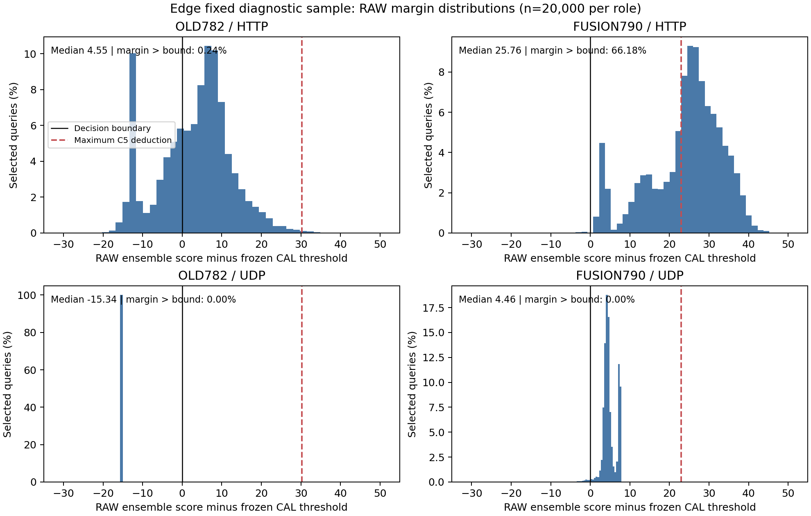

# 四组固定模型评价验收与修复方向

结果：四阶段工程验收 PASS；融合模型显著恢复 Edge 攻击检出，但整套科学验收未通过。
影响：UDP 集成检出 0→98.66%；HTTP C5 样本检出 31.195%→94.995%；同时 Edge C5 正常误报 0.475%→5.79%，A/B RAW 正常误报退化，C5 设备级安全门失败。
下一步：封存全部种子；优先用已有超算分数/特征定位正常误报和种子差异，再制定仅源域拟合的稳定融合/C5修复；本轮未启动新训练、未调阈值。

## 工程验收

|阶段|作业|耗时|MaxRSS|
|---|---|---:|---:|
|PREFLIGHT|182427|7分27秒|908.0 MiB|
|CONTEXT|182429|1分13秒|222.5 MiB|
|AB|182430|1分24秒|1701.7 MiB|
|EDGE|182431|0分31秒|859.9 MiB|

四阶段累计 10分35秒，1 CPU / 8 GiB，峰值约1.662 GiB，全部 COMPLETED/0:0。SHA 清单、冻结评价源码、四组全部种子、计数与比率、本地取回回执均通过复核。模型与大数组未下载。

真实预检重新编码7个原始完整批次、112行，E3最大误差0；4条查询针对4,124条合法参考重算距离，缓存/新编码支持误差均0。Edge完整统计覆盖5,074,623物理帧、60,000查询，恢复比对33,962查询；最大时钟债0.854643秒。A/B与Edge全量旧头评分复算误差0，旧C5判定一致。完整流式阶段的 independent_checks=0 是按设计只在小切片执行独立oracle，不能误写成全量独立oracle验证。

## Edge：固定选中样本，集成结果

以下每个源角色分母均20,000；HTTP/UDP是攻击关联查询检出率，并非独立攻击事件检出率。

|模型/方法|正常误报|HTTP检出|UDP检出|
|---|---:|---:|---:|
|OLD782 / RAW|16806/20000 (84.0300%)|13266/20000 (66.3300%)|0/20000 (0.0000%)|
|OLD782 / C5_P3|95/20000 (0.4750%)|6239/20000 (31.1950%)|0/20000 (0.0000%)|
|REFIT782 / RAW|16806/20000 (84.0300%)|13266/20000 (66.3300%)|0/20000 (0.0000%)|
|REFIT782 / C5_P3|95/20000 (0.4750%)|6239/20000 (31.1950%)|0/20000 (0.0000%)|
|STATS8 / RAW|19409/20000 (97.0450%)|19995/20000 (99.9750%)|0/20000 (0.0000%)|
|FUSION790 / RAW|16699/20000 (83.4950%)|19966/20000 (99.8300%)|19732/20000 (98.6600%)|
|FUSION790 / C5_P3|1158/20000 (5.7900%)|18999/20000 (94.9950%)|19732/20000 (98.6600%)|

抽样展开 HT 总体估计另列，不能与上述样本比率混用：

|模型/方法|正常FPR HT估计|HTTP HT估计|UDP HT估计|
|---|---:|---:|---:|
|OLD782 / RAW|85.3888%|66.6463%|0.0000%|
|OLD782 / C5_P3|0.0640%|28.2563%|0.0000%|
|REFIT782 / RAW|85.3888%|66.6463%|0.0000%|
|REFIT782 / C5_P3|0.0640%|28.2563%|0.0000%|
|STATS8 / RAW|99.2071%|99.9879%|0.0000%|
|FUSION790 / RAW|84.9135%|99.8367%|98.6600%|
|FUSION790 / C5_P3|5.5313%|94.4239%|98.6600%|

## 全种子结果与稳定性

|模型/方法|头|正常误报数|HTTP检出数|UDP检出数|C5安全门|
|---|---|---:|---:|---:|---|
|OLD782 / RAW|27|16777|13975|0|不适用：RAW无撤警|
|OLD782 / RAW|127|16639|10971|0|不适用：RAW无撤警|
|OLD782 / RAW|227|16451|12468|0|不适用：RAW无撤警|
|OLD782 / RAW|ensemble|16806|13266|0|不适用：RAW无撤警|
|OLD782 / C5_P3|27|11|6506|0|FAIL|
|OLD782 / C5_P3|127|116|4210|0|FAIL|
|OLD782 / C5_P3|227|90|5005|0|FAIL|
|OLD782 / C5_P3|ensemble|95|6239|0|FAIL|
|REFIT782 / RAW|27|16777|13975|0|不适用：RAW无撤警|
|REFIT782 / RAW|127|16639|10971|0|不适用：RAW无撤警|
|REFIT782 / RAW|227|16451|12468|0|不适用：RAW无撤警|
|REFIT782 / RAW|ensemble|16806|13266|0|不适用：RAW无撤警|
|REFIT782 / C5_P3|27|11|6506|0|FAIL|
|REFIT782 / C5_P3|127|116|4210|0|FAIL|
|REFIT782 / C5_P3|227|90|5005|0|FAIL|
|REFIT782 / C5_P3|ensemble|95|6239|0|FAIL|
|STATS8 / RAW|27|19446|19995|0|不适用：RAW无撤警|
|STATS8 / RAW|127|19381|19995|0|不适用：RAW无撤警|
|STATS8 / RAW|227|19399|19994|0|不适用：RAW无撤警|
|STATS8 / RAW|ensemble|19409|19995|0|不适用：RAW无撤警|
|FUSION790 / RAW|27|16673|19974|19529|不适用：RAW无撤警|
|FUSION790 / RAW|127|16746|19524|19876|不适用：RAW无撤警|
|FUSION790 / RAW|227|16573|19967|19670|不适用：RAW无撤警|
|FUSION790 / RAW|ensemble|16699|19966|19732|不适用：RAW无撤警|
|FUSION790 / C5_P3|27|147|18962|19529|FAIL|
|FUSION790 / C5_P3|127|5047|18263|19876|FAIL|
|FUSION790 / C5_P3|227|51|19113|19670|FAIL|
|FUSION790 / C5_P3|ensemble|1158|18999|19732|FAIL|

FUSION790/C5 的正常误报种子差异为0.735%、25.235%、0.255%。不能按Edge效果选择227或剔除127，也不能把集成5.79%包装成稳定低误报。STATS8单独模型UDP仍0检出，正常误报97.045%；证据支持本次融合的作用，不能得出“宏观速率单独即可泛化检测”的结论。

## A/B 主评价窗口

以下为集成，分母沿用冻结 primary_indices/primary_weights；加权率是既有分层权重口径。完整视图保留超算，SHA见AB_RESULT。

|数据集|模型/方法|正常加权FPR|正常未加权FPR|攻击加权召回|攻击未加权召回|
|---|---|---:|---:|---:|---:|
|CIC_DEV|OLD782 / RAW|4.8095%|0.0739%|100.0000%|100.0000%|
|CIC_DEV|OLD782 / C5_P3|0.1737%|0.0042%|99.9557%|99.8216%|
|CIC_DEV|REFIT782 / RAW|4.8095%|0.0739%|100.0000%|100.0000%|
|CIC_DEV|REFIT782 / C5_P3|0.1737%|0.0042%|99.9557%|99.8216%|
|CIC_DEV|STATS8 / RAW|0.0831%|0.0729%|99.9200%|99.9330%|
|CIC_DEV|FUSION790 / RAW|5.5269%|0.1031%|100.0000%|100.0000%|
|CIC_DEV|FUSION790 / C5_P3|0.2337%|0.0229%|99.9987%|99.9937%|
|UNSW_DEV|OLD782 / RAW|23.6957%|39.8984%|99.9946%|99.9931%|
|UNSW_DEV|OLD782 / C5_P3|0.5452%|1.5475%|99.9946%|99.9931%|
|UNSW_DEV|REFIT782 / RAW|23.6957%|39.8984%|99.9946%|99.9931%|
|UNSW_DEV|REFIT782 / C5_P3|0.5452%|1.5475%|99.9946%|99.9931%|
|UNSW_DEV|STATS8 / RAW|5.1216%|15.9677%|0.0027%|0.0055%|
|UNSW_DEV|FUSION790 / RAW|27.1110%|53.8942%|99.9913%|99.9862%|
|UNSW_DEV|FUSION790 / C5_P3|0.5605%|1.7449%|99.9913%|99.9862%|

A/B封存门失败主要来自RAW正常误报：A加权FPR从4.8095%升至5.5269%，B从23.6957%升至27.1110%；各种子的正常误报增幅也超过0.1个百分点。旧RAW本来就不满足低误报绝对门，原先低误报成绩主要是C5后口径，不能混写。

融合+C5在A/B仍维持较好成绩：A加权FPR0.2337%、召回99.9987%；B加权FPR0.5605%、召回99.9913%。A/B各头C5安全门通过，RAW协议攻击防退化门通过；源CAL20项检查通过。不能将RAW门失败概括为攻击能力灾难性遗忘，也不能以C5好成绩绕过冻结RAW门。

## 裕量与C5撤警

HTTP融合集成RAW裕量中位数25.7636，最大扣分界22.9146；仅66.18%样本裕量大于该界。早先“+40至+60”“C5扣不动”只是预期，本轮没有证明。HTTP撤警7027→967，但设备级加权损失仍1.7750个百分点，大于1个百分点上限；HTTP场景损失3.5501个百分点虽在5个百分点内，不能替代设备级门。四个融合头的Edge C5安全门均失败。

UDP融合RAW裕量中位数4.4602，仍非大裕量；本次实际扣分为0，所以C5保持98.66%。这不证明未来参考支持改变后仍抗撤警。

## 证据含义与下一步

旧782与REFIT782在A/B和Edge全部已报告指标完全一致；融合获得明显不同结果，且编码/距离重放无差异。这支持新增上下文与融合训练确实改变了判别能力，不支持把本轮现象归因于模型没加载或编码器失效。它也不是对所有数据处理细节的无限保证。

下一步建议先做已有工件诊断：按种子/协议/设备/抓包段比较正常误报交集，联合RAW裕量、参考支持、C5扣分与8维源域覆盖度；重点解释127为何失稳。再用冻结输入做模型内上下文消融及固定尺度对照，区分新增输入、原782权重漂移、阈值/尺度变化的贡献。这些诊断不用于选择Edge最佳种子或外部调阈值。

在归因完成后，才决定是否采用保留旧头的受约束上下文修正、源域正常约束或调整C5与融合分数的接口；这些都是待验证候选，并非已经证明的修复。训练与阈值继续只用源域，A/B防退化保持完整，Edge属于已消耗诊断集。要主张独立泛化还需另行登记未使用的确认数据。

本轮只验收与封存，没有新增超算作业、训练或性能选择。

证据：[工程回执](../../device_context_evaluation_v1_20261105/FINAL_EVALUATION_ACCEPTANCE.json)、[独立回执复核](../../device_context_evaluation_v1_20261105/COMPLETION_AUDIT.json)、[A/B结果](../../device_context_evaluation_v1_20261105/AB_RESULT.json)、[Edge结果](../../device_context_evaluation_v1_20261105/EDGE_RESULT.json)、[图表SHA](../../device_context_evaluation_v1_20261105/ARTIFACT_SHA256.json)。
