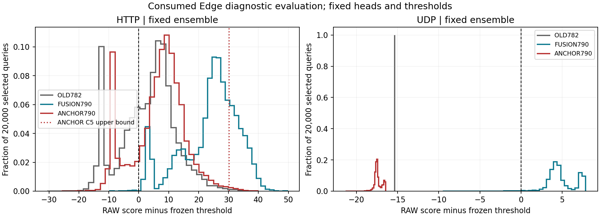

结果：真实预检、A/B和Edge工程验收通过；ANCHOR790科学验收FAIL，不采用为替代模型。
影响：正常误报和127种子异常显著收敛，但Edge UDP三种子及集成检出全部归零，HTTP收益大幅回退。
下一步：封存负结果；建议先用现有冻结头做8维贡献干预和源FIT锚定/BCE梯度冲突诊断，不直接调λ、挑种子/轮次或追加完整训练。

# 2026-11-05 锚定790三数据集评价验收

## 工程与证据

用户授权后，PREFLIGHT 182554（3:03）、AB 182555（1:21）、EDGE 182556（0:37）均COMPLETED/0:0；累计计算5分01秒，最大Slurm MaxRSS 1.6911 GiB，均1CPU/8GiB。真实预检重新编码112行、7个原始批次，编码与距离复算误差均0；正式评价复用已验收缓存，不是重新跑全原包。没有工程失败或重试。

五组模型、27/127/227及float64集成全部保留；第40轮端点、源CAL阈值、自身FIT尺度、归一化、因果8维和C5 p3/λ=0.25/SYN保护均固定，无训练、阈值拟合、选种子或选轮次。四组旧对照的UID顺序、全量判定由worker逐项校验；全量分数与旧数组最大差为0。预检不同批大小的最大差3.815e-6且判定相同。另用本地审计核对868项旧对照池级指标，与旧封存结果一致。

## Edge主结果（固定样本口径）

每个角色20,000个固定查询，以下为集成的样本率；不混同HT总体估计、分层权重率或独立攻击事件召回。

| 模型 | 方法 | 正常误报 | HTTP攻击关联检出 | UDP攻击关联检出 |
|---|---|---:|---:|---:|
| OLD782 | RAW | 16806/20000 (84.030%) | 13266/20000 (66.330%) | 0/20000 (0.000%) |
| OLD782 | C5_P3 | 95/20000 (0.475%) | 6239/20000 (31.195%) | 0/20000 (0.000%) |
| REFIT782 | RAW | 16806/20000 (84.030%) | 13266/20000 (66.330%) | 0/20000 (0.000%) |
| REFIT782 | C5_P3 | 95/20000 (0.475%) | 6239/20000 (31.195%) | 0/20000 (0.000%) |
| STATS8 | RAW | 19409/20000 (97.045%) | 19995/20000 (99.975%) | 0/20000 (0.000%) |
| FUSION790 | RAW | 16699/20000 (83.495%) | 19966/20000 (99.830%) | 19732/20000 (98.660%) |
| FUSION790 | C5_P3 | 1158/20000 (5.790%) | 18999/20000 (94.995%) | 19732/20000 (98.660%) |
| ANCHOR790 | RAW | 16622/20000 (83.110%) | 15769/20000 (78.845%) | 0/20000 (0.000%) |
| ANCHOR790 | C5_P3 | 116/20000 (0.580%) | 9302/20000 (46.510%) | 0/20000 (0.000%) |

ANCHOR790集成C5正常误报0.580%，对应HT总体估计0.07778%、正常组件等权0.68135%、原分层权重率6.08790%。分母/权重回答不同问题，不能用0.58%宣称所有正常风险口径已达标。原FUSION790集成C5对应5.790%、5.53127%、5.82673%、9.33231%。

### 三种子保留

| 新ANCHOR790 | RAW正常误报 | C5正常误报 | RAW HTTP检出 | C5 HTTP检出 | RAW/C5 UDP检出 |
|---|---:|---:|---:|---:|---:|
| 27 | 16606/20000 | 116/20000 | 16029/20000 | 9001/20000 | 0/20000 |
| 127 | 16472/20000 | 116/20000 | 13743/20000 | 7211/20000 | 0/20000 |
| 227 | 16254/20000 | 82/20000 | 14878/20000 | 7788/20000 | 0/20000 |
| ensemble | 16622/20000 | 116/20000 | 15769/20000 | 9302/20000 | 0/20000 |

127种子C5正常误报5047→116（25.235%→0.580%）；三种子正常判定分歧4996→34行。这是当前固定样本上的误报收敛，不能脱离攻击损失声称稳健修复。

## A/B主分母与加权结果

A主视图175,097行（正常96,041、攻击79,056）；B主视图146,997行（正常74,444、攻击72,553）。正式全量分别179,886与148,316行，全量指标及分数留超算。

| 数据集 | 集成模型/方法 | 正常误报数 | 样本FPR | 加权FPR | 攻击检出数 | 样本召回 | 加权召回 |
|---|---|---:|---:|---:|---:|---:|---:|
| CIC_DEV | OLD782/RAW | 71/96041 | 0.073927% | 4.809546% | 79056/79056 | 100.000000% | 100.000000% |
| CIC_DEV | OLD782/C5_P3 | 4/96041 | 0.004165% | 0.173727% | 78915/79056 | 99.821645% | 99.955716% |
| CIC_DEV | REFIT782/RAW | 71/96041 | 0.073927% | 4.809546% | 79056/79056 | 100.000000% | 100.000000% |
| CIC_DEV | REFIT782/C5_P3 | 4/96041 | 0.004165% | 0.173727% | 78915/79056 | 99.821645% | 99.955716% |
| CIC_DEV | STATS8/RAW | 70/96041 | 0.072886% | 0.083129% | 79003/79056 | 99.932959% | 99.919980% |
| CIC_DEV | FUSION790/RAW | 99/96041 | 0.103081% | 5.526880% | 79056/79056 | 100.000000% | 100.000000% |
| CIC_DEV | FUSION790/C5_P3 | 22/96041 | 0.022907% | 0.233716% | 79051/79056 | 99.993675% | 99.998731% |
| CIC_DEV | ANCHOR790/RAW | 71/96041 | 0.073927% | 5.127833% | 79054/79056 | 99.997470% | 99.999430% |
| CIC_DEV | ANCHOR790/C5_P3 | 11/96041 | 0.011453% | 0.578820% | 78914/79056 | 99.820380% | 99.954879% |
| UNSW_DEV | OLD782/RAW | 29702/74444 | 39.898447% | 23.695674% | 72548/72553 | 99.993108% | 99.994632% |
| UNSW_DEV | OLD782/C5_P3 | 1152/74444 | 1.547472% | 0.545222% | 72548/72553 | 99.993108% | 99.994632% |
| UNSW_DEV | REFIT782/RAW | 29702/74444 | 39.898447% | 23.695674% | 72548/72553 | 99.993108% | 99.994632% |
| UNSW_DEV | REFIT782/C5_P3 | 1152/74444 | 1.547472% | 0.545222% | 72548/72553 | 99.993108% | 99.994632% |
| UNSW_DEV | STATS8/RAW | 11887/74444 | 15.967707% | 5.121612% | 4/72553 | 0.005513% | 0.002663% |
| UNSW_DEV | FUSION790/RAW | 40121/74444 | 53.894202% | 27.110961% | 72543/72553 | 99.986217% | 99.991298% |
| UNSW_DEV | FUSION790/C5_P3 | 1299/74444 | 1.744936% | 0.560510% | 72543/72553 | 99.986217% | 99.991298% |
| UNSW_DEV | ANCHOR790/RAW | 27100/74444 | 36.403202% | 24.219173% | 72539/72553 | 99.980704% | 99.986599% |
| UNSW_DEV | ANCHOR790/C5_P3 | 953/74444 | 1.280157% | 0.670323% | 72539/72553 | 99.980704% | 99.986599% |

A/B C5样本误报都比前版融合降低，但加权FPR分别升至0.578820%和0.670323%，说明误报减少未均匀覆盖各权重组。A的C5攻击召回回到接近旧头的99.820380%；B为99.980704%。原RAW科学门仍FAIL（A失败4项，B失败9项），用户接受旧A/B取舍不等于把本轮新失败改成PASS。A/B新头四个head的C5安全门均PASS。所有原门详细结果在FINAL_EVALUATION_ACCEPTANCE.json。

## 定位到哪里，尚未证明什么

1. **UDP在分类头RAW阶段就失败。** 新集成RAW阈值裕量中位数−17.492、最大值−16.441，20,000条全部低于阈值；C5实际扣分全部0。前版融合裕量中位数+4.460，旧782约−15.337。因此不能归因于C5撤警，也不能靠增加运行时间解决。新UDP裕量并非完全相同，不能声称8维完全没有被读取或使用。

2. **HTTP同时损失RAW裕量并遭更强撤警。** 前版→锚定集成RAW检出99.830%→78.845%，裕量中位数25.764→7.999；C5最大修正上限22.915→30.252，实际扣分中位数5.774→7.622，超过上限的RAW裕量占比66.18%→0.52%。C5检出94.995%→46.510%，撤警967→6467。设备级加权撤警损失1.775→11.683个百分点，超过1个百分点预算；HTTP场景23.366个百分点超过5个百分点预算，且触发低RAW召回时禁止任何撤警的原门。UDP撤警门PASS仅因没有可撤的RAW报警，绝不代表检出合格。

3. **方法假设未成立。** 四组旧模型在同一输入路径复现；新头SHA、790维输入、归一化和源阈值身份核验通过。本轮结果与“全样本向弱UDP教师分数锚定，牺牲新增统计带来的决策收益”一致，但这仍是解释假设，未通过新头8维消融/梯度干预证明。不能回写成已证实提取错误，也不能将先前768维利用结论推翻。

图使用worker封存的每模型40箱直方图；不同模型箱宽不同，纵轴为各自每箱样本占比，不能将高度直接当成同箱宽密度比较。主要比较阈值两侧与水平位置；HTTP红色虚线为新模型C5最大修正上限。

## 下一步建议与边界

保留原FUSION790作为待改进候选、OLD782作为冻结基线；本轮ANCHOR790封存为负结果，不替换主候选。先用现有端点做小规模诊断：在固定样本身份下比较真实8维、归一化后置零及预登记的同设备/协议内置换，测量RAW分数增量与裕量；这属于干预诊断而非新的有效成绩。结合已保存源FIT探针/模型，按正常与攻击分开检查锚定项和BCE/TAIL梯度的方向与量级，判断约束是否压制上下文学习。只读分析可使用全部预定端点，但不按Edge结果挑轮次或λ。

只有诊断支持后才封存新的源域目标（例如限制正常风险、保留攻击裕量的约束，而不是强迫全部输出模仿旧头）；具体形式尚未确定，本轮未启动新的训练/调参作业。不能保证减弱锚定或仅正常锚定就能解决问题。Edge已被反复诊断消费，新方法完成后仍需要未参与开发的独立验证，当前不能作为新鲜外部确认。

## 归档

`runs/fusion_anchor_evaluation_v1_20261105/FINAL_EVALUATION_ACCEPTANCE.json`区分工程PASS与科学FAIL；COMPARISON保留全五组/三种子/集成，AB_RESULT/EDGE_RESULT保留完整取回摘要与裕量，EVALUATION_COMPLETION是自动工程完成回执，不改写其原始pending语义。大数组路径/SHA见验收文件remote_artifacts，留超算。审计脚本audit_results.py与小回执、图和SHA一起封存。
