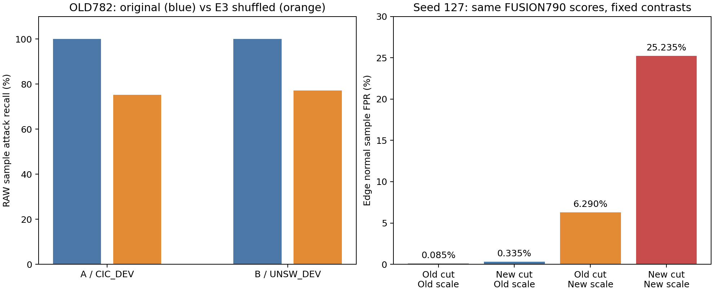

# 768维使用、误报与种子差异：诊断验收

结果：诊断完整通过。768维正确进入分类头且有显著功能作用，在A/B上具有明确判别价值；不能说它没有被利用。
影响：Edge UDP的输入表示近乎恒定，新增8维补充了原单流输入缺失的上下文；误报/127差异定位到融合分数、源CAL阈值和C5尺度的共同作用。
下一步：保留全部结果，围绕正常分数结构约束及C5尺度兼容性设计源域修复；不直接采用Edge反事实工作点。本轮无新训练、无调参。

## 工程与解释范围

预检182478用时7分55秒，完整诊断182486用时3分27秒，总11分22秒，峰值3.0805GiB；均1CPU/8GiB，COMPLETED/0:0。三数据池、四模型、三个种子和集成全部覆盖，原分数复算最大误差0。float64分块分解最大误差0.000193976，没有判定跨阈值变化；旧782与REFIT782全部诊断摘要一致。大数组仍在超算，当前只核对回执/冻结源码/摘要算术，未重新下载数组或重放原包。

## 768维有没有被有效使用

逐批独立构造标准化输入与正式适配器精确一致，检查了768/14/8列位置。权重不为零和梯度非零只作为通路证据；真正的功能证据来自同协议内UID置换及固定模型分块消融。

下表均为原782集成RAW、主评价窗口、未加权样本比率。置换仅改变768维，14维不动，两个UID种子均注册且全报告；该干预会破坏跨块依赖，不是新模型正式成绩。

|数据池|原攻击召回|E3置换后召回（种子20261105/20261106）|原正常FPR|E3置换后FPR（两次）|
|---|---:|---:|---:|---:|
|CIC_DEV|100.0000%|75.1758%/75.1859%|0.0739%|19.5864%/19.6073%|
|UNSW_DEV|99.9931%|77.1560%/77.2180%|39.8984%|61.4556%/61.3374%|

融合模型置换E3也使A召回降至75.93%、B约79.91–79.96%。同类Q14置换引起的A/B攻击判定变化很少。证据支持E3在A/B判别中承担重要作用，但不等于证明768维每一维都有效、编码器已最优或具有充分跨域泛化能力。

Edge UDP 20,000条攻击查询只有1种tokenized输入指纹；E3有2种float32行（浮点差异），768维标准差最大约3.07e-8，没有维度超过1e-6；Q14完全相同。8维统计则有19,982种行。不能把浮点行数2解释为两种有效行为。

融合头将新增8维置为约定的标准化零参考后，UDP检出由19,732/20,000降到0；保留E3和Q14、恢复真实8维后回到98.66%。这证明8维在当前融合头的UDP决策中起关键作用。单独训练的STATS8模型仍然0检出，因此不是“8维取代768维”。维度数不代表是否包含跨连接信息。

HTTP变化更复杂：融合头将8维归零后仍检出19,992/20,000，甚至略高于完整输入19,966；但置换真实8维会降低HTTP检出。这表明不能把HTTP全部提升算成8维的直接加分，原782部分权重、偏置、阈值与非线性交互也已改变。

零参考与置换都可能离开真实联合分布。全零时全报警是偏置和冻结阈值共同决定的，不能由“删掉E3后100%召回”反过来声称E3无用，必须同时看正常误报。

## 正常误报与127差异：近端计算机制已定位

同一批Edge正常查询，在融合头内相对指定零参考的E3块贡献中位数：27为-2.4233，127为+3.0960，227为-3.9897；8维贡献中位数均约-8。该Shapley分解依赖参考点，不能当作独立因果效应或跨模型贡献的唯一比较标准。

127的5,047条正常误报，RAW裕量中位数26.1575，参考支持中位数0.999679；新最大扣分为0.25×95.98065=23.99516。即使参考支持接近满值，C5也不足以压回很多已超过扣分上限的正常报警。其正常误报中8维贡献全部为负，且没有一行8维超出源FIT各维min/max；不支持“8维数值溢出直接抬高正常分数”的解释，但单维范围内不排除联合分布漂移。

127源CAL阈值从-19.73696变为-23.31520，降低3.57824（更容易报警）；C5上限从30.34366降为23.99516。下面固定融合模型和同一批输入，只替换登记过的阈值/尺度：

|127诊断配置|正常误报数/20,000|误报率|HTTP检出数/20,000|UDP检出数/20,000|
|---|---:|---:|---:|---:|
|旧阈值＋旧尺度|17|0.085%|15145|19178|
|新阈值＋旧尺度|67|0.335%|17152|19876|
|旧阈值＋新尺度|1258|6.290%|16400|19178|
|新阈值＋新尺度|5047|25.235%|18263|19876|

新阈值与新尺度组合存在明显交互，不能把两项效果简单相加。全2×2×2对照还包括原分数函数。若对误报计数的三个因素作顺序平均分摊，127相对原模型多出的4,931条分摊为分数函数1,010、阈值1,661、尺度2,260；这只是有限诊断对照的计数归因，交互已按规则分配，不是训练因果占比。

全部种子/集成固定融合分数的四种对照如下；分母均20,000正常查询：

|阈值/尺度|种子27误报|种子127误报|种子227误报|集成误报|
|---|---:|---:|---:|---:|
|OLD782/OLD782|16|17|0|16|
|FUSION790/OLD782|16|67|0|17|
|OLD782/FUSION790|150|1258|16|641|
|FUSION790/FUSION790|147|5047|51|1158|

## 为什么不能直接改回旧尺度

保持新融合分数与新阈值、只用旧尺度，集成正常误报1158→17（5.79%→0.085%），但HTTP检出18999→17662（94.995%→88.31%），UDP仍19732。增强扣分会再次撤掉更多HTTP真阳性，未证明满足C5安全门；这不是已验收的修复方案。

B同样显示尺度兼容问题：固定新分数/新阈值，旧尺度时正常误报132条，新尺度时1299条；A则18→22。不能把Edge诊断最佳工作点作为源域校准规则。

## 哪些问题仍未完全查明

- 已验证当前模型正确消费768维，没有漏拼、加载错模型或原评分不能复现的证据；不是对所有前端语义的一次无限保证。
- 已定位稳定复现的误报计算机制及127特有工作点的放大作用。尚未从训练轨迹严格证明为什么该种子学出这种边界，不应称梯度爆炸、优化器错误或随机运行故障。
- 局部梯度、权重非零、置换敏感性不等于对未见域有效；尤其UDP表示恒定而原边界打低分，仍说明输入可观测信息/跨域边界存在限制。
- 分组明细、逐维梯度和逐样本对照数组已留超算；本地报告的误报证据主要基于完整正常池与预注册摘要，未新增训练或选择最佳种子。

## 下一步修复方向

优先保留已经有效的768维通路。设计受源域正常约束的上下文修正，避免融合训练随意改变原正常分数结构；同时重新核验C5对新分数单位和裕量的适配方式，兼顾正常压分与HTTP撤警。需要在源FIT/CAL上制定、固定方案，再完整执行A/B防退化和全种子评价，不能通过Edge选择尺度/阈值或剔除127。训练轨迹归因可复用已保存的训练诊断，作为候选约束设计依据。此处是修复方向，尚未提交训练。

证据：[执行复核](../../representation_usage_diagnosis_v2_20261105/COMPLETION_AUDIT.json)、[全诊断摘要](../../representation_usage_diagnosis_v2_20261105/DIAGNOSE_RESULT.json)、[派生对照表](../../representation_usage_diagnosis_v2_20261105/DIAGNOSTIC_TABLES.json)、[超算大工件SHA](../../representation_usage_diagnosis_v2_20261105/REMOTE_ARTIFACTS.json)。
