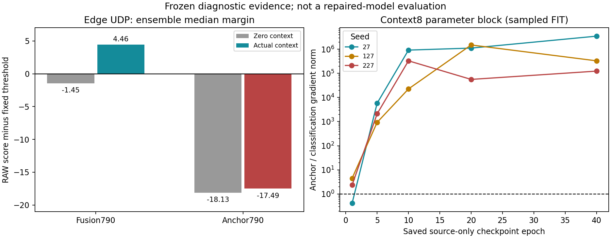

结果：诊断验收PASS；支持“全分数锚定导致上下文收益减弱并改变基底决策”的修复方向，上一轮模型科学FAIL保留。
影响：8维实际被使用；UDP失检包含上下文增益缩小和8维置零基底裕量下降，不能归结为8维未读取。源FIT早期有目标冲突、后期锚定数据梯度占优。
下一步：保留原FUSION790，停止沿用全样本模仿旧782分数的目标；先封存保攻击裕量、约束正常风险的源域小试方案。本轮未启动新训练。

# 2026-11-06 8维贡献与锚定目标冲突诊断验收

## 工程验收

182560/182561/182562均COMPLETED/0:0，耗时1:07、0:58、1:09，累计3分14秒；均1CPU/8GiB。进程采样峰值1.684GiB，Slurm采样MaxRSS峰值1.399GiB，采样口径分别保留。预检112行/7原始批次，编码/距离误差0。三数据集两组头全量RAW分数与前轮数组完全相同，源梯度快照和外部评价端点指纹一致；1,408组干预计数/分位数关系验算通过。21个预定模型快照、每点64批源FIT查询，无训练更新、阈值拟合、种子/轮次筛选。大数组与逐批明细仍留超算。

## 1. 8维是否用上？用了，作用在锚定版中显著减弱

定义：上下文贡献为同一个冻结头、同一条查询的s(真实8维)−s(归一化8维置零)。这是受控输入干预，不等于单独8维分类器性能；置零代表源FIT log特征均值，可形成不自然输入。

Edge UDP，集成，固定20,000查询：

| 指标 | 原融合FUSION790 | 锚定ANCHOR790 |
|---|---:|---:|
| 真实8维RAW检出 | 19732/20000 (98.66%) | 0/20000 |
| 8维置零RAW检出 | 0/20000 | 0/20000 |
| 8维贡献中位数 | +5.9091 | +0.6365 |
| 8维置零时阈值裕量中位数 | −1.4489 | −18.1285 |
| 真实8维阈值裕量中位数 | +4.4602 | −17.4920 |

因此这里有两个同时发生的变化：上下文抬分减少约5.27分；置零基底裕量再下降约16.68分。“置零基底”是各自训练后的790头在context=0时的输出加其冻结阈值，并不是直接换成旧782头。这些中位数差是描述性比较；不能把不同模型的参数变化和CAL阈值变化混称为某个输入块的独立因果效应。

三个种子UDP的上下文贡献中位数：

| 种子 | 原融合 | 锚定 |
|---|---:|---:|
| 27 | +4.6478 | +2.3398 |
| 127 | +7.5039 | -1.6029 |
| 227 | +5.5723 | +1.1745 |

127的UDP上下文贡献甚至反向（−1.6029），不是全局等比例缩小。8列权重范数在锚定末期并未消失（约2.60—3.08），所以参数范数或非零列不能代替功能贡献。

正常样本上的8维通常压低分数，不能把8维当作误报的唯一来源。以下全部为RAW、固定主视图样本计数，未应用C5，也不替代加权科学指标：

| 数据集 | 模型 | 真实8维误报数 | 置零误报数 | 真实8维对分数贡献中位数 |
|---|---|---:|---:|---:|
| CIC_DEV | FUSION790 | 99/96041 | 839/96041 | -8.7142 |
| CIC_DEV | ANCHOR790 | 71/96041 | 111/96041 | -3.1585 |
| UNSW_DEV | FUSION790 | 40121/74444 | 58323/74444 | -8.3692 |
| UNSW_DEV | ANCHOR790 | 27100/74444 | 31882/74444 | -2.7388 |
| EDGE | FUSION790 | 16699/20000 | 17665/20000 | -7.9253 |
| EDGE | ANCHOR790 | 16622/20000 | 16835/20000 | -2.5928 |

Edge HTTP上下文贡献中位数+4.4028→+1.1327。原融合HTTP RAW检出置零后19966→19992虽然略升，裕量中位数却25.7636→21.3090；分位数和检出计数不能互相代替。锚定HTTP置零后15769→15465。

两次同设备/协议内联合8维置换均报告：原融合Edge UDP检出19254/19255（约96.27%），锚定仍0；原融合HTTP18225/18200，锚定14979/15011。UDP组供体仍以UDP攻击为主（原固定集正常UDP仅497），高率统计在该协议组中仍大量保留，置换后召回不大降并不能反证8维没用。置换不看标签、结果或抓包角色，所有组singleton=0；也不保证供体后的联合输入在真实分布上。

## 2. 锚定与分类目标是否冲突？早期明确，后期主要是量级失衡

固定源FIT 16,384行，正常3,666、攻击12,718；沿用原类别/组权重与n/batch缩放。每个快照重算全FIT正常tail再抽128个负样本；是当前状态目标的固定抽样估计，不是历史Adam更新重放。

第1轮快照，三个种子均出现有意义量级下的负平均梯度点积：

| 种子 | 全参数余弦 | 全参数锚定/分类范数 | 8列参数余弦 | 8列参数锚定/分类范数 |
|---|---:|---:|---:|---:|
| 27 | -0.4394 | 1.3547 | -0.3747 | 0.4115 |
| 127 | -0.1974 | 3.4286 | -0.5899 | 4.4536 |
| 227 | -0.1992 | 2.0548 | -0.4303 | 2.3368 |

分类指BCE_NORMAL+BCE_ATTACK+TAIL，锚定指ANCHOR_NORMAL+ANCHOR_ATTACK。负点积表示无穷小锚定下降方向会一阶增加所测分类目标，不代表所有batch或所有轮次相反。初始三个种子平均方向同向；第1轮分开看同类BCE与同类锚定也并非普遍反向，合并后的目标包含跨项和TAIL作用。因此不能将现象简化成“攻击锚定单独导致全部问题”。

后期的主要证据是分类目标已经接近饱和，锚定数据梯度远大于它：

| 种子 | 40轮8列分类梯度范数 | 40轮8列锚定梯度范数 | 比值 | 全参数比值 |
|---|---:|---:|---:|---:|
| 27 | 2.144e-11 | 7.434e-05 | 3.467e+06 | 9.213e+06 |
| 127 | 1.358e-10 | 4.477e-05 | 3.298e+05 | 7.343e+05 |
| 227 | 2.319e-10 | 2.860e-05 | 1.234e+05 | 2.111e+05 |

这些是原目标数据梯度，不包含Adam预条件、历史动量或权重衰减，不能直接换算成实际更新占比。部分batch分类梯度≤1e−12，按冻结门标为夹角不可解释；其他很小梯度即使高于该门也仍须谨慎。第40轮三个种子8列平均点积均为负，但127全参数平均方向为正，否定“全程、全块一致冲突”的说法。

完整训练日志也支持后期目标失衡：第40轮BCE均值约1.11e−9、3.72e−9、2.02e−9，TAIL约1e−16；锚定约6.03e−5、5.89e−5、3.59e−5，占各自总loss超过99.99%。该日志来自实际训练全轮，不是固定梯度子样本。源域分类足够容易，正确分类几乎不再施加强梯度，进一步优化主要在拟合教师的具体分数。

正常类锚定项同样不能忽略：末轮三个种子8列NORMAL_ANCHOR范数约8.10e−5、4.52e−5、1.86e−5，均与NORMAL_BCE平均梯度反向；所以“只锚定正常类”尚不是验证过的解决方案。原融合头本身源分类也饱和，这不证明其实现错误；在其末期快照上计算的锚定项只是反事实新增目标，不能冒充原融合实际训练损失。

右图仅连接预定源域快照作导航，未评价中间轮次的Edge成绩，不代表连续训练轨迹或可据此选择early stop。

## 3. 可以确定的修复方向与尚未证明的部分

证据支持撤销当前“让全部样本输出模仿旧REFIT782教师具体logit”的设计：它不仅控制分数尺度，还约束了学习到的决策函数；教师本来缺少Edge UDP检出能力。模型身份、输入拼接和原始打分复现通过，8维有显著干预效应，排查重点应转向目标设计与决策裕量，而不是重复提取768/8维。这里的通过仅覆盖已检查的固定输入路径，不是对所有未来数据处理的保证。

建议下一版以原FUSION790为保留检测能力的基线，分别规定正常风险上界和攻击裕量保护，避免再次将全部输出拉回弱教师。先形成单一源域小试执行卡，再训练/校准，最后统一报告A/B/已消费Edge全部种子。源FIT硬负例是否有足够覆盖和有效梯度，必须作为该方案的设计/预检门；如果没有，就不能预期单靠当前饱和BCE继续微调解决外部误报。具体损失形式与权重尚未封存。

不直接减小λ碰运气、不按Edge选checkpoint、不把正常类单独锚定视为已证实修复，也不宣称简单仿射重标分就能改进已同步变换阈值/尺度的判定。下一步需要保留原模型已取得的UDP/HTTP收益，同时处理正常风险；任何单项误报下降都不能代替共同验收。

本轮尚未完成历史逐步因果重构，不能定位哪一轮丢掉Edge UDP能力；也没有证明下一目标必然成功。A/B、Edge已用于开发诊断，未来论文仍需明确这类证据的角色，并使用未参与开发的独立验证支持泛化结论。

## 4. 归档与状态

验收：`runs/context_anchor_diagnosis_v1_20261105/FINAL_DIAGNOSIS_ACCEPTANCE.json`。DIAGNOSTIC_SUMMARY保留跨数据集/全种子与全部预定快照；原RESULT回执和自动DIAGNOSIS_COMPLETION不改写。remote_artifacts记录超算大数组路径/SHA，逐批梯度JSON SHA另列。当前无新作业，未改训练代码、模型、阈值或C5。
