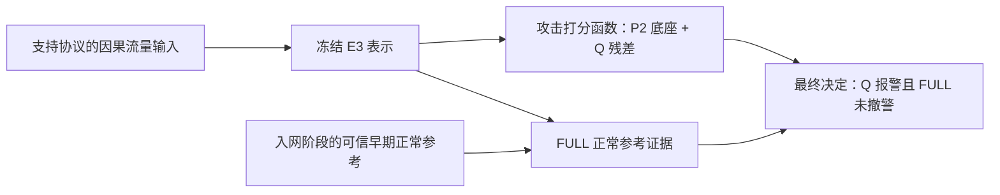

# 攻击迁移与系统职责：诊断结果及修复方向

日期：2026-09-28。状态：限定诊断完成；新能力实验未启动；修复实现和新科学协议尚未冻结。

## 1. 当前判断

当前最优先处理的是**模型每次判断时到底看到了什么**，随后才是攻击学习与正常适应如何联合工作。保存结果显示，每台外部设备从第 7 条选中攻击查询起，全部保存分数长期恒定，跨越三个攻击速率区间。源码和纯合成复现确认：当前前缀保留连接最早的有限内容，容量满后不滚动；仍变化的 `flow_duration` 又没有进入实际编码器。因此现在不应直接追加检测头、增加训练轮数，或宣布需要全面替换前端。

这不是“已证明所有漏检都是截断造成的”。实际 flow 和 E3 数组没有随拉回包返回；相同分数不能反向证明输入相同。早期片段如果已包含攻击证据，固定前缀也可能检出，成功设备即提示这一点。当前结论是：存在已复现的输入时效盲区，且与真实恒分现象强烈对应，必须在选择新训练方法之前核实其实际影响。

第二个已确定问题独立存在：FULL 正常参考机制会撤销真实攻击告警。即使恢复 Q 的部分攻击能力，也不能自动得到合格的最终系统。系统整理应明确输入、攻击证据、正常适应和最终决定的职责，不以删除几个模块为目标。

## 2. 原结果不改写

Job176975 工程完成，冻结科学门槛 FAIL。75,763 正常查询、72,553 攻击查询、92 早期正常参考；五台设备、一个外部采集环境、15 个窄 SYN 注释区间。以下是保存决策，未重新推理。

| 路径 | 攻击检出率 | 正常逐样本误报率 | 原主指标：分层加权正常误报率 | 相对本身 Q 新增攻击漏检 |
|---|---:|---:|---:|---:|
| Q | 59.9369% | 5.3034% | 2.6129% | 0 |
| RAW | 59.9369% | 0.1703% | 1.6612% | 0 |
| FULL | 39.8068% | 0.0634% | 0.7532% | 14,605 |

RAW 是实验对照，不事后升为原主方案。其正常改善高度集中在 Samsung；FULL 的正常误报降低是真实观察，但不能据此宣称跨设备联合适应已经解决。独立 ID 仍为 NOT_RUN。原结果报告为 `legacy_commissioning_unsw_recovery_job176975_result_20260928.md`。

## 3. 保存分数定位到的失效路径

### 3.1 大分母里重复了什么

| 设备 | 攻击查询数 | 共享同一 Q 分数的查询数 | 该设备全部保存分数的联合状态数 |
|---|---:|---:|---:|
| WEMO Motion | 14,553 | 14,547 | 7 |
| WEMO Switch | 14,513 | 14,507 | 7 |
| Samsung | 14,506 | 14,500 | 7 |
| TP-Link | 14,604 | 14,598 | 7 |
| Netatmo | 14,377 | 14,371 | 7 |

按 timestamp/frame 排序，各设备前六条为非众数，从第七条一直到三个速率区间结束，Q 三 seed、参考证据三 seed 及各集合分数组成的 13 维向量完全不变。每台只有一个攻击 session/component。七种状态不能当作七次独立试验，72,553 个查询也不能当作同等数量的独立攻击泛化证据。原查询分母继续保留，不删重复查询来改变结果。

该现象提示后续速率/行为可能未被持续反映；**它不证明输入相同，不证明分数必须随速率单调变化，也不证明攻击标签有误**。

### 3.2 Q 与 FULL 都有独立责任

- Q 对 Motion 14,553 条和 Samsung 14,506 条全部漏检，三个 seed 一致。最高 logit 分别为 -6.1907、-7.1776，远低于冻结阈值对应的 -2.6635，并非几个阈值边缘点。
- R 对这些攻击原本都报警，Q 修正后告警消失。但 R 同时误报 70,421/75,763 个正常查询，直接保留所有 R 正例不满足低误报目标。R 连续分数未返回，尚不能拆出每条 residual 的具体幅度。
- TP-Link 有 14,602 个 Q 正确告警被 FULL 全部撤销；Netatmo 另有三个，恰为其第 2、3、4 条选中攻击查询。九个参考路径的保存决定均与原否决公式逐项完全一致，未发现分数方向或公式应用错误。
- Motion 还有被当前 Q 漏检掩盖的第二层问题：全部攻击有合法参考，FULL 相似证据为 0.9186–0.9885，高于原 cut=0.00001。**若保持表示、参考、验证器和 cut 不变，只把 Q 的决定修正为报警，FULL 仍会撤销这些报警。**这是一条条件性的公式推论，不是一次新模型实验。
- TP-Link 的 FULL 相似证据为 0.7111–0.9678，RAW 为 0.3726–0.4694。RAW 未新增漏检，FULL 全部撤警；两者的 cut 不同，不能只归罪于投影而忽略校准。正确与匹配错误设备参考都会造成 TP-Link 全漏，尚不支持稳定的个体正常性学习。
- Samsung TCP、Switch TCP 只有一个参考，按原规则回退 Q；不能把 Switch 的攻击保留计为 FULL 学习成功。参考充足也不能保证保护：Motion TCP 有 44 个参考仍存在上述风险。

完整可复算结果位于 `../legacy_unsw_attack_transfer_diagnosis_v1_20260928/scores/`。

## 4. 输入语义审计，以及对旧解释的更正

实际链路是：owner/capture/规范双向五元组隔离上下文 → 每方向最多保留最早 12 个 burst、每 burst 最早 6 包 → translator 再保留合计最早 12 个 burst → tokenizer/collator → E3。

这里 144 包是上游缓存上界，translator 最多保留 72 包；不能把 144 当作最后模型一定看见的包数。状态不因 `tcp.stream` 改变、空闲时间或进入另一个攻击区间自动重置。不能按攻击标签重置；是否采用部署可实现的会话生命周期，需要新协议明确。

上限达到后，后续包内容可不再进入表示。`flow_duration` 会继续变化，也经过 tokenizer/collator，但实际 `base_transformer` 参数没有它，后续池化同样不读取它。字节、包数、IAT 等对应的是被保留的 burst，不是覆盖全部后续流量的累计统计。

本轮验证包括：

1. 使用原样源码声明的两条生成序列：密集单向流第六包后、稀疏序列第十二个 burst 后，继续改变 flags/window，除 duration 外的流字段完全不变。
2. 独立生成七包反例，执行原 tokenizer/collator 数值方法：第七包改变 flags/window，并使窄攻击端点谓词从不满足变为满足，实际送入 E3 的张量字段与 position_ids 仍完全相同。前六包仅为未标注合成包，不称认证正常流量。未加载模型、未做 forward。
3. 九份关键源码与实际 recovery bundle 字节一致。未发现恢复执行器将一个分数广播给整条流；它逐 UID 快照、逐批编码，但不同 UID 的有效内容仍可重复。

**历史更正：**9 月 25 日桥接测试已经覆盖前缀饱和、目标字段可能被丢弃和 translator 二次截断，当时任务是保持原前端语义。旧报告认为 duration 尚可能反映最新时刻，本轮沿实际 E3 调用链排除了这个兜底解释。原先“保真/因果审计通过”仍有效，但不能扩大为“持续检测所需的信息完整”。原先对 CIC 的 11 条短上下文漏检的调查也不能由此推翻：那批目标保留、未达容量上限，与本次不同。

因此问题定性为**冻结的初始流量摘要与持续检测任务之间的语义局限**，尚非此次恢复程序造成的新工程回归；调整窗口、状态更新、统计或打包都属于新的输入协议，不能偷偷作为零科学影响补丁上线。

独立审查与复现位于诊断目录 `architecture/`、`prefix_review/`。

## 5. 系统应该怎样讲清楚

当前实际主链只有以下职责；实验表里的全部臂并没有同时串进系统：

| 部分 | 应承担的责任 | 目前应纠正的理解 |
|---|---|---|
| 输入与状态管理 | 当前判定能使用哪些过去信息；状态更新/过期；支持范围 | 因果、不泄漏未来，不等于能够感知后续变化 |
| P2+Q | 输出攻击证据，Q 是旧分数加残差 | 不是两套独立投票；冻结旧权重不等于保留最终攻击能力 |
| 入网参考与 FULL | 表达该设备已观察到的正常行为 | 正常相似不能自动当作非攻击证明；新设备入网没有更新模型参数 |
| 最终决定 | 统一规定攻击证据与正常证据怎样共同产生告警 | 需要明确适用/回退与错误代价；一个出口不等于必须只有一个网络 |
| RAW、NO_CF、历史 M/C | 对照和消融，检验复杂机制有无独立价值 | 不计入同时部署的模块数量 |

简化的标准是职责可解释、训练目标与输出契约一致、有不可替代的增益、成本合理。不能为了看起来简单机械合并，也不能对每个漏检加一个设备特例。独立 ID、支持覆盖、参考不足、攻击漏检、正常误报都须如实计入，不能以“未知/不确定”出口隐藏困难样本。

## 6. 训练与历史经验限制了哪些修复思路

Q 已经不是当前重新做 few-shot：六台 CIC 设备、766,727 条训练查询，其中 599,087 攻击。选中攻击为 TCP 531,950、UDP 66,453、Hydra 684；没有 HTTP 活动行。合法训练来源候选确有 53,856 条 SYN，但最终选中清单不含 SYN/payload 子类，候选数不能冒充实际训练 SYN 分母。不能声称完全没见过 SYN，也不能声称本次攻击已经充分覆盖。

FULL 已经做过最坏合法参考的攻击保护损失、变化参考预算和训练侧留设备难正常加权，不能把这些重新包装成未尝试的方法。原 CAL 上零攻击撤警也不构成跨数据源保证。历史 M/C 已经尝试参考条件分类器；简单“合成一个头”同样不是新的突破依据。

候选解释按证据排序：

1. **输入时效不足**：代码反例已证实，真实输入对应待补。
2. **跨来源攻击学习不足/来源捷径**：同环境训练全对、外部整设备全漏与之相符，但不能从结果指定 TTL 或窗口大小为已证实根因。
3. **正常参考学习及校准外迁失败**：错误撤警已证实，不能仅凭相似度决定哪个新损失一定有效。

这三者可能同时存在。修复输入并不能免除训练支持和 FULL 的责任，也不能保证性能自动恢复。

## 7. 针对性的原始文献核对

本轮通过浏览器直接阅读以下原始资料。仅用于约束设计，不借论文自报性能承诺本项目效果，也没有下载新数据或权重。

- Cantone、Marrocco、Bria，**On the Cross-Dataset Generalization of Machine Learning for Network Intrusion Detection**，2024，IEEE Access，原文 https://arxiv.org/html/2402.10974v1 ，DOI 10.1109/ACCESS.2024.3472907。重点核对 §3.3、§4.3–4.4、§5：同数据集近完美与跨数据集失效可以并存，同名攻击受工具/配置影响，许多流量行可能只有极少不同特征。这支持检查信息多样性与来源覆盖，不能把它当作本项目已找到具体捷径的证据，也不照搬其参数搜索。
- Beltiukov 等，**netFound: Principled Design for Network Foundation Models**，arXiv v5，2026-05-12，https://arxiv.org/html/2310.17025v5 。重点核对 §2–3、§5–6：协议语义、时序/运行环境信息、burst/flow 层次、6 包/12 burst 截断及预训练来源限制。它支持区别“有限流摘要”与我们要求的持续判定，不能证明换滚动窗口必然更好。**公开 v5 描述不等于本地旧固定 checkpoint 与 vendor 已自动升级；本次运行语义以封存源码为准。**

既有 ICLAD、InCTRL、Conformal Risk Control 与 QREF 设计已记录在 9 月 10/22 日文档，本轮没有把这些旧参考假称为新发现。既有最坏参考保护已实际失败于外部数据，因此下一方案须在有效观察内容/任务多样性上提供新证据，不能只换术语。研究浏览记录摘要另存诊断目录 `research_notes.json`。

## 8. 选定的下一步：核验已有缓存，收敛修复合同

**先实现并审查一个只读的已保存输入核验工具，再由用户按原超算方式运行/拉回。它不训练、不重新计算 E3、不解码 PCAP。**目的只有一个：区分“有效输入已经停止更新”和“输入变化了，但模型给出相同判断”，从而决定最小修复层级。详细字段、可判定条件和停止规则见诊断目录 `next_cached_input_audit_spec.md`。本轮没有远程执行。

优先复用 Job176975 已封存的 flow shard 和 E3 特征数组：复验原 pins、UID/顺序、按五台设备和三个速率对齐；分别统计不含 unused duration 的源字段哈希与保存特征哈希。二者是不同层级，不能把 flow 哈希称作最终张量哈希；若需追到实际 tensor，须复现原 worker、批次 16 和 tokenizer/collator 打包顺序，仍不调用模型。现有 flow 不含源帧到 token 映射，无法凭空补出目标包是否保留；若确实需要真实出处追踪，另列固定小范围方案，不在该工具里偷偷重解码。

这一步只做一次完整摘要，不围着几条错例反复挑样本。若确认有效输入恒定，进入**持续可见的因果输入协议**设计：明确判定单位、最新行为怎样进入、部署时怎样更新/过期，优先评估能否继续使用已有 E3，而不是重新发起全协议前端工程。最新有限窗口、服务/设备级行为统计是候选信息载体；是否需要二者、是否增加学习通道，必须由缺失信息和训练侧覆盖决定，不预先堆叠。

若源字段和特征实际变化而 Q 仍恒定，则降低截断解释的优先级，转查打包/表示敏感性和 Q 学习；不能继续无限调整窗口。若只有相同短初始片段可用，仍要承认其可能已有攻击信号，不能用输入冻结为两台设备全漏免责。

无论哪个分支，后续方法需要同时满足：攻击学习跨来源而非记设备；正常参考改进正常判断时有攻击对照；训练/参考/校准/测试输入同义；不使用未来或攻击区间决定状态；旧模型作为固定历史对照。窗口变更后旧 normalizer、Q、FULL 和阈值的有效性均需重新论证，不能只换 UNSW 输入沿用旧分数门槛就报告提升。

本批 UNSW 已被用于失败诊断，后续据此设计只能把它当开发证据。最终迁移确认需要未参与设计的数据；独立 ID 和旧能力回归也仍待合法安排。当前没有可以诚实承诺的恢复百分比或完成日期。

## 9. 范围与接续

实际完成：保存分数复算、训练来源元数据核对、部署结构与代码对照、两条静态合成序列、一条独立 tokenizer/collator 反例、两篇原始研究核对、诊断和下一输入核验规格。

未执行：真实模型推理/训练/校准、阈值搜索、原始流量解码、数据下载、远程操作或新的评估。原 recipe、seed、模型、分母、旧 FAIL 结果和历史保护池未改。HEAD `4b28747`、分支 `codex/exp-mainline` 保持；八项无关工作区修改以原 SHA 清单保护。

solved: 定位真实长段恒分、Q 整设备漏检与 FULL 错误撤警；确认 input duration 未入编码器；系统模块职责已澄清。

changed_mainline: yes，下一工作优先级收敛为实际输入时效核验和修复合同，不是立即训练或增加检测模块。

active_blocker: 实际有效输入/保存特征对应未拉回；跨域攻击学习和正常撤警仍不合格。

frozen: 原 Job176975 结果及全部科学配置，旧失败，ID_NOT_RUN，外部预训练完整暴露 UNRESOLVED。

superseded: 泛泛“继续加强检测头”的下一步方向；不覆盖历史实验数值，也不将旧保真 PASS 改为工程 FAIL。

next_action: 实现并审查只读缓存输入核验器，复用已封存产物；随后依据固定判定分支冻结最小语义修复。真实执行范围单独明确，不逐文件重复授权。
