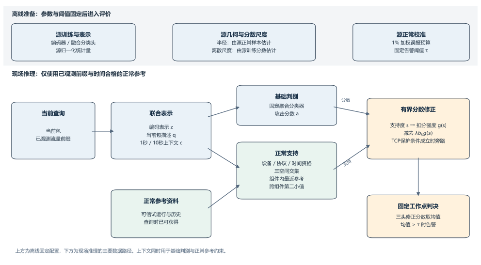

# 基于上下文约束正常参考的物联网入侵检测

IoT Intrusion Detection with Context-Constrained Normal References

## 1 引言

物联网入侵检测面临一个直接影响部署可用性的矛盾：在离线正常数据上标定的低误报工作点，进入现场设备流量后可能产生大量告警。在本文的UNSW智能设备建档后评价与Edge-IIoTset外部评价中，同一基础检测器采用源校准集上1%的加权误报预算，两处的普通误报率却分别达到53.89%和83.50%，对应的分层加权误报率也达到27.11%和78.95%。这意味着，攻击检测能力之外，正常行为能否在既定阈值下被正确接纳，同样决定系统的实用价值。本文研究分类器与阈值在部署期间保持固定、现场仅提供正常建档与历史资料的设置，目标是在保留攻击告警的同时抑制正常流量造成的告警负担。

更强的分类器并不自动带来可靠的部署工作点。参数高效集成模型TabM（ICLR 2025）是现代深度表格学习的代表方法[1]。在本文共享输入的比较中，其在独立Edge-IIoTset评价上获得接近0.999的AUROC（0.998991），但在同一评价集上，固定源校准阈值下的普通误报率仍为78.84%；在UNSW建档后视图中，普通误报率为26.38%。另一方面，采用正常样本训练检测头的SLAD[4]在Edge-IIoTset上仅有0.23%的普通误报率，却只检出0.03%的HTTP攻击查询。这些结果揭示了工作点评价的两个要求：高排序质量不能代替低误报，低误报也必须与攻击检出联合考察。因此，本文研究如何在既有攻击判别能力的基础上，利用现场正常证据抑制误报并限制额外攻击损失。

正常参考提供了这样的补充证据，但它同时带来覆盖与安全性的挑战。短期试运行只能观察设备正常活动的一部分，未被覆盖的合法行为仍可能持续触发告警。扩展历史覆盖并加强相似性扣分，可以接纳更多正常查询；然而，当攻击查询在编码表示与协议描述上也接近正常参考时，同样的扣分可能撤销正确告警。正常参考检测的关键因而不只是寻找相似样本，而是确定：**哪些相似性证据足以支持降低攻击分数？**

为此，本文提出基于上下文约束正常参考的物联网入侵检测框架。其核心设计是将设备入站上下文作为正常参考支持的必要条件：用于支持查询的同一条正常参考必须在通信编码、当前包属性和设备运行状态三个空间中同时相容，查询还须从至少两个不同通信组件获得这样的匹配。这样，参考能否用于减分由局部通信与设备状态的联合匹配决定。完整合法历史提供正常活动覆盖，离线分数尺度控制允许的扣分幅度，上下文交集限制哪些查询可以使用这部分额度；三者分别对应覆盖、幅度和相容性三个设计问题。

该机制在固定工作点下取得了明确收益。在UNSW测试床的建档后评价中，完整系统将普通误报率从基础检测器的53.89%降至0.282%，同时保持72,543/72,553条攻击关联查询告警。在未参与开发的Edge-IIoTset外部评价中，正常查询误报率由83.50%降至0.120%，HTTP和UDP攻击查询检出率分别为99.79%和98.66%。同参考库、同扣分尺度的受控消融进一步表明，上下文约束比仅使用编码与协议描述的修正多保留2,296条HTTP攻击告警，仅增加7条正常告警。这一对照将上下文的价值定位于攻击告警保全，与历史覆盖和扣分幅度对误报抑制的作用相区分。

本文的主要贡献如下。

1. **将设备上下文用于约束正常参考的适用性。** 在时间合格的正常历史上构建三空间交集支持，使上下文参与基础判别的同时，成为参考减分的必要匹配条件；结合跨组件支持与有界修正，在固定分类器和阈值下利用现场正常证据。
2. **分离参考覆盖、扣分幅度与上下文约束的作用。** 给出同尺度条件下的层次化告警保全性质，并通过历史覆盖对照与同库几何—尺度析因消融，检验正常误报削减和额外攻击损失分别如何受这些因素影响。
3. **在固定工作点下联合评价误报与攻击检出。** 在CIC和UNSW开发测试床以及未参与开发的Edge-IIoTset外部测试床上，报告系统收益、攻击代价、设备及种子差异，并通过现代检测头的排序指标与阈值表现说明评价固定工作点的必要性。

## 2 方法

### 2.1 问题设置与框架

设查询\(i\)为受保护设备流量中的一个待判别包及其已观测上下文。离线训练的分类器输出攻击对数几率\(a_i\)，较大值表示更强的攻击倾向；告警阈值\(\tau\)由源正常校准集确定。部署阶段固定分类器参数和阈值，通过正常参考集\(\mathcal R_i\)计算支持度\(s_i\)，对攻击分数作单向、有界修正。

系统允许访问设备试运行和历史资料中已知正常的参考流量，现场推理不访问待判别查询的真实标签。参考来源具有正常身份且满足时间资格，是方法的输入条件。基础分类器负责攻击判别，正常参考负责提供撤警依据；上下文交集则约束这一依据何时成立。缺少合格参考时，系统直接使用基础分数。开发测试床的带标签评价用于方法选择，独立外部测试床仅用于评价，具体数据角色见3.1节。

本文关注已有攻击流量中的检测与错误撤警问题，正常参考库被视为可信输入，未标注的现场查询不会因本次低分判决而自动进入参考库。系统观察设备相关流量的包级描述和入站状态；判断过程中不使用待评价查询的真实标签。参考污染和根据检测器反馈主动构造的自适应逃逸不属于当前评价条件。

图1概括离线固定参数与现场推理之间的关系。框架将基础攻击判别与正常证据的相容性检验分开：上下文一方面进入分类器，另一方面作为参考匹配的必要条件。本文重点研究后一路径，即在已有攻击分数上判断正常历史是否足以支持减分，并限制局部相似性导致的错误撤警。这一路径的作用通过固定基础分类器的同库消融单独检验。

**图1. 系统流程示意。** 源训练与校准阶段确定分类器、归一化、几何半径、扣分尺度和告警阈值。现场推理中，基础判别与正常支持分别计算，在有界减分后使用固定阈值告警。图中的箭头表示数据依赖，不表示实测时延。

### 2.2 通信、包属性与设备入站状态的联合表示

系统以一个待判别网络包为查询，利用该包及其到达时已经观察到的流量构造输入。单个包的属性、它所属通信的近期行为，以及设备同时接收的流量，描述了不同范围的信息。例如，一个包的协议字段可能与正常流量相似，但它到达时的设备入站流量可能已经显著增加。为同时描述这些信息，本文为每个查询构建通信编码、当前包描述和设备入站上下文三个特征块。

**通信编码：描述同一通信关系中的近期包序列。** 对当前查询所在的双向通信，收集同一设备和采集记录内近期已经观察到的包，将其头部字段及时间、方向等信息输入netFound-base编码器[9]，得到768维表示\(\mathbf z_i\)。该表示由预训练模型提取，用于概括单个包之外的通信信息。编码器采用官方预训练权重，在本研究中保持固定；我们训练的是随后使用这些特征的分类头。编码输入不包含载荷内容，前缀截取、输出提取及归一化规则见附录B.4–B.5。

**当前包描述：显式保留待判别包的属性。** 将当前包的TCP/UDP协议类型、TCP标志位、长度、窗口字段和方向等属性组成14维向量\(\mathbf q_i\)，各维定义见表A3。这些特征直接描述眼前的包，与从近期包序列中提取的通信编码共同作为判别输入。

**设备入站上下文：描述设备近期接收流量的状态。** 在同一采集记录内，汇总到达该设备、与当前包协议相同的流量，分别在最近1秒和10秒窗口计算四项统计：入站包速率、IP字节速率、不同源身份数和不同有向五元组连接数。两个窗口各提供四个数，共形成8维向量\(\mathbf c_i\)。与通信编码不同，这些统计可以覆盖设备的多个通信关系，从而反映单段通信之外的流量规模及来源、连接数量。两个窗口分别描述较短和较长时间范围内的活动；统计窗口截至当前包到达时，只使用已处理的流量；当前包符合入站条件时也计入统计，不访问未来流量。

上述三组特征按顺序拼接，构成每个查询的790维输入：

\[
\mathbf x_i=[\mathbf z_i;\mathbf q_i;\mathbf c_i]\in\mathbb R^{790},
\qquad \mathbf z_i\in\mathbb R^{768},\quad
\mathbf q_i\in\mathbb R^{14},\quad \mathbf c_i\in\mathbb R^8.
\tag{1}
\]

其中，\(i\)表示查询索引，分号表示特征拼接。分类头根据\(\mathbf x_i\)输出攻击对数几率，即数值越大、攻击倾向越强的判别分数。编码表示和入站上下文的归一化统计量仅由源训练集估计，评价时保持固定，具体数值规则见附录B.5。

三组信息共同用于基础分类，并分别保留为参考匹配空间。基础分类器学习这些信息与攻击标签的关系；正常参考模块则进一步要求设备上下文与局部通信同时相容。这一设计将上下文从判别输入扩展为参考减分的必要条件，使“通信形式相似”还需满足“运行状态相容”的要求。两条作用路径分别由4.5节的表示对照和4.3节的同库匹配对照检验，较高入站流量本身不直接触发告警。

### 2.3 正常参考的访问资格与通信组件分组

正常参考为当前查询提供设备既往正常行为的比较依据。参考库由已知正常的建档和历史资料构成，其中的样本使用与查询相同的三组特征表示。使用这些资料前，需要解决两个问题：哪些参考在当前时刻有资格参与判断，以及如何避免把同一通信关系中的大量重复样本当成多组支持。

**参考访问资格。** 对查询\(i\)，仅使用同一评价分区、同一设备和同一传输协议的参考，并要求相应参考库已经完成建档、达到可用时间。具体而言，查询时间须晚于该库的截止时间；若参考与查询位于同一采集记录，还须满足查询帧超过建档截止帧，且参考帧早于查询帧。以两小时建档库为例，建档期间的查询不能使用这套完整库，即使其中部分参考已经在查询之前出现。本文的完整历史库指满足既定选取和访问规则的参考集合，不包含查询之后才可获得的正常资料；各测试床的构建范围和生效规则见3.5节。

**通信组件分组。** 时间和身份合格之后，将参考按其所属通信关系分组，称为通信组件。一个组件由受保护设备、传输协议和两端的IP地址与端口共同确定。两端按固定顺序记录，因此同一关系中的发送包和返回包属于同一组件。例如，同一设备使用两个不同本地端口与同一服务器通信，会形成两个组件；同一关系中反复出现的包则仍归入一个组件。采集记录身份进一步区分该组件在不同记录中的会话。组件身份由数据构建规则确定，不根据查询分数重新聚类。

**跨组件支持要求。** 正常参考支持需要至少两个不同组件分别提供符合相容性约束的参考。同一组件中无论存在多少相似包，都只贡献一组候选证据，避免依靠单一通信关系的重复样本满足双组件要求。两个组件可以连接同一远端，也不必对应不同应用或统计独立的活动；该要求限制的是证据来源的重复，并不保证攻击一定不会获得正常支持。若合法组件不足两个，或相应源几何参数不可用，则将支持度\(s_i\)置为0，参考模块不降低攻击分数，保留基础分类器的判断。具体匹配条件与支持度计算见2.4节。

参考覆盖与参考相容性由此承担不同作用：较丰富的正常历史增加可供比较的实例，相容性规则决定这些实例能否支持当前查询的分数修正。有资格进入候选集合的参考，还须通过下一节的三空间匹配，才能提供正支持。

### 2.4 从三空间匹配到正常支持度

为限制局部通信相似带来的错误撤警，正常参考模块将设备运行状态纳入支持成立的条件：用于提供正支持的同一条参考须在通信、包属性和设备状态三个方面都与查询相容，且查询须从至少两个不同通信组件各获得这样的匹配。为此，计算先比较查询与每条合法参考，再在组件内选择最佳匹配，最后根据第二个最佳组件确定正常支持度。下文的支持度描述参考匹配强度，不是查询属于正常流量的概率。

**参考级比较：分别衡量三方面的差异。** 对查询\(i\)与第2.3节筛选出的参考\(r\)，分别计算通信编码差异\(d_z\)、当前包描述差异\(d_q\)和设备入站上下文差异\(d_c\)。这些差异均以较小值表示较接近：编码空间使用余弦差异，包描述和上下文空间使用各维差异的均方根。令\(\mathbf u_i\)为编码向量\(\mathbf z_i\)除以其长度后的单位向量，则

\[
 d_z(i,r)=\operatorname{clip}(1-\mathbf u_i^\top\mathbf u_r,0,2),\qquad
 d_q(i,r)=\frac{\|\mathbf q_i-\mathbf q_r\|_2}{\sqrt{14}},\qquad
 d_c(i,r)=\frac{\|\mathbf c_i-\mathbf c_r\|_2}{\sqrt{8}}.
\]

**三空间交集：以最大归一化差异约束同一条参考。** 三个空间的差异尺度不同，因此分别除以离线标定的半径\(\rho_z,\rho_q,\rho_c\)。归一化差异小于1表示位于该空间的半径以内，达到或超过1则不满足该空间的正支持条件。每个查询按其传输协议使用相应半径；半径由源正常训练数据估计，现场保持固定，标定流程和数值见附录A。为使三个空间同时满足约束，采用其中最大的归一化差异作为联合距离：

\[
 D_{\mathrm{3D}}(i,r)=\max\left\{\frac{d_z(i,r)}{\rho_z},\frac{d_q(i,r)}{\rho_q},\frac{d_c(i,r)}{\rho_c}\right\}.
\tag{2}
\]

3D表示同时使用三个特征空间，并非特征向量只有三维。对完整系统，\(D_{\mathrm{3D}}<1\)当且仅当同一条参考在三个空间中的归一化差异均小于1。最大值使某个空间的不相容不能被其他空间的高度相似抵消，也不允许分别从不同参考中抽取最有利的单项差异来拼成匹配。

为隔离上下文约束的作用，另定义无上下文对照\(D_{\mathrm{2D}}(i,r)=\max\{d_z(i,r)/\rho_z,d_q(i,r)/\rho_q\}\)。该对照只去掉匹配中的上下文项，基础分类器保持不变，用于后续消融及命题1。以下以\(v\)标记匹配方式，完整系统取\(v=\mathrm{3D}\)。

**组件内选择：每个组件取最小联合距离。** 同一组件可能包含多条参考，系统从中寻找对当前查询最匹配的一条。令\(\mathcal R_i\)为合法参考集合，\(\operatorname{comp}(r)\)为参考的组件身份；组件\(b\)的最佳匹配距离为

\[
 m_{ib}^{(v)}=\min_{r\in\mathcal R_i:\,\operatorname{comp}(r)=b}D_v(i,r),
 \qquad v\in\{\mathrm{2D},\mathrm{3D}\}.
\tag{3}
\]

这里先为每条参考计算联合距离，再在组件内取最小值。若该组件要提供正支持，其最佳参考本身须同时满足所用空间的约束。每个组件最终贡献一个距离值，同一通信关系中增加重复参考不会增加支持来源的数量。

**跨组件汇总：用第二小距离确定支持度。** 将不同组件的最佳匹配距离从小到大排列，令\(m_{i,(2)}^{(v)}\)表示第二小值。最小值只说明一个组件匹配良好；第二小值小于1，才说明至少两个不同组件分别提供了满足全部空间约束的参考。以第二小距离确定强度，使支持由两个最佳组件中较弱者的匹配程度决定；第二个组件仅接近相容边界时，整体支持也相应较弱。正常支持度定义为

\[
 s_i^{(v)}=\operatorname{clip}\left(1-m_{i,(2)}^{(v)},0,1\right).
\tag{4}
\]

\(\operatorname{clip}(x,0,1)\)将结果限制在0到1之间。第二小距离小于1，意味着至少两个不同通信组件分别提供了满足全部空间约束的参考；该距离越小，正常支持越强。第二小距离达到或超过1，或合法组件不足两个时，支持度为0，参考模块保留基础判决。

完整计算遍历全部合法参考，上下文约束可以改变各组件中的最佳匹配及最终提供支持的组件。上述过程要求至少两组通信来源分别提供三空间相容的参考，不依赖组件之间统计独立的假设。得到的支持度将在2.5节映射为有界减分；具有正支持并不直接等于撤销告警。

### 2.5 支持度驱动的有界分数修正

基础分类器给出的攻击分数与正常参考支持承担不同作用：前者衡量查询的攻击倾向，后者决定能否及在多大程度上降低该分数。本文将修正幅度分解为固定的扣分上限与随查询变化的额度比例，在保持分类器和告警阈值不变的条件下利用正常参考。

**基准尺度与扣分上限。** 对第\(k\)个分类头，使用离线标定的基准对数几率离散度\(b_k\)作为修正的分数单位。它由不含入站上下文的基准分类头在完整源训练集上的输出确定：将分数从低到高排序，以累计训练权重确定10%与90%分位数，再计算二者之差。该统计同时包含正常和攻击样本，用于描述分数分布的跨度。当前融合分类器沿用这三个固定尺度，推理时无需再次运行基准分类头。

修正系数\(\lambda\)决定取基准尺度的多大比例作为上限，因此第\(k\)个头最多降低\(\lambda b_k\)个分数单位。当前采用\(\lambda=0.25\)，即基准跨度的四分之一。该取值继承早期源校准选择：在候选集合\(\{0,0.05,0.1,0.25\}\)中，取未新增撤销源校准攻击告警的最大候选；当时四档均通过，因而选择0.25。该选择限定于当时的候选范围与配置，后续部署和外部评价不重新调整，具体来源见附录A。

**将支持度映射为扣分比例。** 在固定上限内，使用\(g(s)=1-(1-s)^3\)将几何支持度转换为实际使用的额度比例。直接采用\(g(s)=s\)对应线性修正；当前映射对\(0<s<1\)给出更大的比例，同时保持\(g(0)=0\)、\(g(1)=1\)和单调递增。因此，它提高已有正支持的修正力度，但不使零支持查询获得减分，也不提高最大扣分额度。错误匹配的攻击查询同样可能受到更强修正，故该映射的效用需结合误报与攻击检出评价。指数3由早期两空间系统的开发比较确定，当前三空间系统沿用该取值；选择记录见附录A，当前配置的敏感性分析见4.7节。

令\(a_i^{(k)}\)为当前融合分类头对查询\(i\)的基础攻击分数，\(G_i\)为2.7节定义的修正旁路指示。完整修正为

\[
 \widetilde a_i^{(k)}=a_i^{(k)}-\lambda b_k g(s_i^{\mathrm{3D}})(1-G_i),
 \qquad \lambda=0.25.
\tag{5}
\]

其中，\(\lambda b_k\)给出每个头的固定上限，\(g(s_i^{\mathrm{3D}})\)给出当前查询的扣分比例，\(1-G_i\)控制是否应用修正。扣分属于\([0,\lambda b_k]\)；支持度为0或旁路指示为1时保持基础分数。实际采用的\(b_k\)与当前融合头自身的分数离散尺度\(\sigma_k\)不同，两者的同条件比较见4.3节，数值与等价系数见附录A。

**修正后的告警判定。** 三个头分别完成修正，再以算术平均得到集成分数\(\bar a_i=\frac13\sum_{k=1}^3\widetilde a_i^{(k)}\)。当\(\bar a_i>\tau\)时告警。集成阈值\(\tau\)单独使用源正常校准查询确定，不由三个头的阈值平均得到，也不随现场支持度改变。正常支持只有在扣分足以使原告警分数降至阈值或以下时才会撤销告警；否则，系统仍保留该告警。

### 2.6 层次化告警保全与撤警条件

上下文约束为正常参考增加了一项匹配要求，因此只能削弱或保持原有支持，不能使参考扣分更强。在其他条件相同时，三空间修正保留的告警不少于两空间修正；同时，由于两种修正均只降低基础分数，它们产生的告警都来自基础检测器原有的告警集合。下面给出这一逐查询关系及其成立条件，再分析哪些原有告警会被撤销。

**Proposition 1（Hierarchical Alarm Preservation，层次化告警保全）.** 对同一查询集，两种修正共享基础分类器分数、合法参考集合、组件划分、公共空间的离线半径、支持映射\(g\)、非负扣分尺度\(\lambda b_k\)、保护指示\(G_i\)及告警阈值；三空间修正仅额外加入固定的上下文距离约束。采用式(2)–(5)及共同的参考不足回退规则时，对每个查询和分类头有

\[
 s_i^{\mathrm{3D}}\le s_i^{\mathrm{2D}},\qquad
 \widetilde a_i^{(k),\mathrm{2D}}\le
 \widetilde a_i^{(k),\mathrm{3D}}\le a_i^{(k)}.
\tag{6}
\]

令\(\mathrm{RAW}\)表示基础分类器未经参考修正的判决，\(\bar a_i^v\)为方法\(v\)的三头平均分数，\(\mathcal A_v=\{i:\bar a_i^v>\tau\}\)为其告警查询集合，则

\[
 \boxed{\mathcal A_{\mathrm{2D}}\subseteq
 \mathcal A_{\mathrm{3D}}\subseteq\mathcal A_{\mathrm{RAW}}.}
\tag{7}
\]

该关系意味着，两空间修正仍然告警的每条查询，在三空间修正下也会告警；三空间修正告警的每条查询，在基础检测器中也会告警。命题对应尺度及其他条件相同的两空间与三空间对照，不直接用于同时更换扣分尺度或阈值的比较。

**证明.** 对每条合法参考，最大值聚合给出\(D_{\mathrm{3D}}(i,r)\ge D_{\mathrm{2D}}(i,r)\)。在同一组件内取最小值仍保持这一关系，因此\(m_{ib}^{\mathrm{3D}}\ge m_{ib}^{\mathrm{2D}}\)。不同组件的距离逐项不减时，排序后的第二小值也不减，即\(m_{i,(2)}^{\mathrm{3D}}\ge m_{i,(2)}^{\mathrm{2D}}\)。式(4)将更大的第二小距离映射为更弱的支持，得到\(s_i^{\mathrm{3D}}\le s_i^{\mathrm{2D}}\)。这个论证不要求两种方法选中同一条参考或同一对组件。合法组件不足两个或公共几何参数不可用时，两者均回退为零支持；若仅上下文几何参数不可用，三空间支持按规则置零，不等式同样成立。

由于\(g\)单调递增，且两种修正共享非负系数\(\lambda b_k(1-G_i)\)，三空间扣分不大于两空间扣分，两者均不增加基础分数，故式(6)成立。算术平均保持分数次序，在同一阈值上作严格大于判定，即得式(7)。\(\square\)

**对误报与攻击检出的含义。** 对固定正常集\(\mathcal N\)和攻击集\(\mathcal P\)，告警集合的包含关系直接给出

\[
 \operatorname{FPR}_{\mathrm{2D}}\le\operatorname{FPR}_{\mathrm{3D}}\le\operatorname{FPR}_{\mathrm{RAW}},\qquad
 \operatorname{Recall}_{\mathrm{2D}}\le\operatorname{Recall}_{\mathrm{3D}}\le\operatorname{Recall}_{\mathrm{RAW}}.
\]

这包含两个参照对象不同的性质：相对基础检测器，单向减分不会增加正常误报；相对同条件两空间修正，上下文约束不会减少已保留的攻击告警。三空间修正更谨慎地撤警，也可能保留更多正常误报。上述率关系适用于非空评价组；采用相同非负权重且分母为正时，加权率也保持相同次序。

命题不保证三空间修正保留全部基础攻击告警，也不能恢复基础检测器已经漏掉的攻击。额外攻击损失由\(\mathcal P\cap(\mathcal A_{\mathrm{RAW}}\setminus\mathcal A_{\mathrm{3D}})\)刻画，即基础检测器原本检出、却被三空间修正撤销的攻击查询。该集合的大小，以及正常误报削减与攻击保全的实际幅度，由后续实验报告。

**从决策裕量理解撤警。** 将基础集成分数超过阈值的幅度记为\(M_i=\bar a_i^{\mathrm{RAW}}-\tau\)。三个头共享同一支持度与保护指示，令平均尺度\(\bar b=\frac13\sum_k b_k\)，则集成分数的实际扣减量为\(\Delta_i^v=\lambda\bar b\,g(s_i^v)(1-G_i)\)。原有告警被撤销的充要条件为

\[
0<M_i\le\Delta_i^v.
\]

其中，\(M_i>0\)表示基础分数原本超过阈值；\(\Delta_i^v\ge M_i\)表示扣分足以将其降至阈值或以下。等号属于撤警情形，因为系统仅在分数严格大于阈值时告警。由\(\Delta_i^{\mathrm{3D}}\le\Delta_i^{\mathrm{2D}}\)，三空间相对两空间额外保留的告警恰好满足\(\Delta_i^{\mathrm{3D}}<M_i\le\Delta_i^{\mathrm{2D}}\)。因此，尺度控制修正的幅度，几何支持控制查询使用其中多少，两者共同决定能否跨过固定判决边界。

### 2.7 推理流程与计算结构

**推理流程。** 离线模型及各项标定参数固定后，系统对每个查询依次执行表示构建、基础评分、合法参考筛选、三空间支持计算、有界分数修正和集成判决。三个分类头共用同一正常支持度，分别修正后取算术平均，在固定集成阈值上作严格大于判定。支持度为0或修正旁路条件成立时，保留基础分类器分数。

**修正旁路规则。** 当前包为TCP、SYN置位且ACK未置位时，令\(G_i=1\)，其余情况为0。该条件对所有设备统一应用，命中的查询不执行正常参考减分，用于限制连接发起类查询的额外撤警。旁路本身不将查询判为攻击，也会保留基础分类器在正常查询上的误报；最终告警仍由分数与阈值的比较确定，其实际收益和代价见4.7节。

**参考匹配的计算量。** 在查询表示已生成、合法候选集合已确定后，设当前查询具有\(n_i\)条参考、\(B_i\)个通信组件，表示总维数为\(d\)。精确距离计算的算术量为\(O(n_i d)\)，组件内最小值归约为\(O(n_i)\)，当前实现通过排序组件最小距离选取第二小值，开销为\(O(B_i\log B_i)\)。设备、协议和时间资格决定实际候选范围，全库行数不等于每条查询的比较数量。参考向量本身的存储量为\(O(Nd)\)，其中\(N\)为参考库总行数；批处理距离矩阵等工作内存另随批量和候选规模变化。这些复杂度描述参考匹配阶段；包含解码、编码、上下文维护和候选构建的端到端时延，以及峰值内存，仍需通过全链路测量确定。

## 3 实验设置

### 3.1 数据用途、测试床来源与时间协议

实验围绕分类器和阈值固定、现场正常历史参与参考匹配的设置展开。为分别评价基础判别、正常参考的作用及其告警代价，数据按源训练、源校准、现场正常参考和评价查询四种用途使用。

**数据用途。** 源数据确定离线模型及相应参数，现场正常参考参与查询时的匹配，评价查询用于检验最终判决。各类数据的职责如下。

|数据用途|数量或组成|使用方式|
|---|---|---|
|源训练|617,908条查询，其中正常134,493条|训练检测头，估计归一化统计量及相应几何/分数尺度；netFound编码器保持官方预训练权重|
|源校准|148,819条查询，其中正常33,147条|正常查询用于告警阈值标定；攻击查询曾用于早期修正系数选择中的新增撤警检查，不用于检测头训练|
|现场正常参考|各测试床的合法正常建档与历史资料，行数见下表|以固定表示提供正常支持，不更新检测头参数；具体构建规则见3.5节|
|评价查询|各测试床选中的正常及攻击关联查询，数量见下表|在固定配置下产生判决，再依据标签统计误报与检出；推理不读取当前查询的真实标签|

评价查询进一步区分开发与外部评价角色。**现场智能设备测试床开发评估（In-situ Smart Device Testbeds）**使用CIC和UNSW流量，评价结果用于方法诊断与开发选择。**独立外部工业物联网测试床评价（External Industrial IoT Testbed, Edge-IIoTset）**检验冻结方法在另一数据来源上的表现；Edge-IIoTset未参与方法开发和参数选择。外部评价使用预先规定的正常建档参考，沿用相同的时间访问约束。

**数据来源与划分。** 源数据来自CIC IoT Dataset 2022[10]的六种设备，设备及逐类数量见表B1；同一数据集中另取HeimVision Camera和Eufy Home Base作开发评价。源训练和源校准按设备内的通信组件整体分配，同一组件不跨两种角色。设备可以同时提供不同组件给训练和校准，因此该划分是组件隔离，不是设备或时间段整体留出。确定性的分配规则见附录B.1。编码表示及上下文的归一化仅使用源训练查询。

UNSW开发评价采用IoT Analytics发布的攻击轨迹[11]，包含Samsung Camera、TP-Link Smart Plug、Netatmo Camera、WEMO Power Switch和WEMO Motion Sensor五种设备。正常查询来自2018年5月28日的正常采集，攻击关联查询来自2018年6月1日的混合采集。额外历史参考来自UNSW IoTraffic档案[12]：所用流量采集于2016—2017年，档案发布于2025年。

Edge-IIoTset使用温湿度正常场景及HTTP、UDP泛洪攻击的三个原始PCAP[13]，受保护对象为同一Raspberry Pi 4边缘/Mosquitto服务器。本研究的评价范围限定于这一个目标及选定场景，查询选择和标签资格见附录B.2。

**评价视图与样本数量。** CIC和UNSW分别报告参考库可用后的建档后视图，以及保留参考尚不可用时查询的完整评价视图。两种视图采用相同的攻击查询集合。下表中的查询数是评价位置数，参考行数是用于匹配的样本数，两者承担不同用途。

|测试床来源|建档后视图正常查询|完整评价视图正常查询|攻击关联查询|完整正常参考行数|
|---|---:|---:|---:|---:|
|CIC视频监控设备|96,041|100,830|79,056|8,863|
|UNSW智能设备|74,444|75,763|72,553|66,082|
|Edge-IIoTset|20,000|—|HTTP 20,000；UDP 20,000|4,124|

建档后视图衡量参考可用后的效果，完整视图同时保留参考尚不可用时的告警代价。下文将完整视图简称为“全时段”，它包含既定查询集合的全部时间位置，并非对原始PCAP全部包评分。Edge-IIoTset仅使用正常、HTTP和UDP各20,000条选中查询，正常查询位于建档后；表中“—”表示未另设包含建档前查询的评价视图。各方法在同一视图中使用相同查询身份。查询数不解释为独立攻击事件数。

**时间协议与攻击范围。** 评价通过已采集流量的前缀重放实施：每个查询只使用当时已观察到的上下文，以及按2.3节规则已可访问的正常参考。CIC不同采集记录之间重置上下文；UNSW历史资料按既定逻辑时间索引重放。Edge正常文件按大于1小时的采集间隔划分为五个上下文段，段间重置前缀状态；最早正常段的两小时参考库继续供后续段使用，不以较晚查询重新建库。历史覆盖对照比较两小时参考与完整合法历史，Edge在该对照中的参考库保持不变。

攻击标签由场景、受保护对象、方向与协议条件共同限定。UNSW的72,553条攻击关联查询均为指定攻击时段内到达受害设备的TCP SYN置位且ACK未置位查询，全部命中2.7节的旁路规则。因此，该池用于评价此类攻击的基础识别与正常误报削减；上下文几何对额外攻击损失的直接证据主要来自Edge-IIoTset的同库消融。

### 3.2 固定工作点与评价指标

评价同时考察正常查询的误报负担与攻击关联查询的检出能力。为区分分数排序质量和实际告警表现，本文在源数据上确定固定工作点，并以普通查询率、分层加权率及适用的抽样总体估计报告现场结果。

**源校准工作点。** 各方法的三个种子级检测器及其集成分别使用源正常校准查询确定告警阈值。在观测到的正常校准分数中，选择使阈值以上权重占正常总权重的比例不超过1%的最小分数作为阈值；只有分数严格大于阈值时才告警，并列分数共同处理。由于经验分数和权重的离散性，实际校准误报率可以低于1%。该预算规定源侧的标定工作点，现场误报与检出表现由评价确定。正常参考修正及其消融沿用相应基础检测器的阈值，不在修正后或目标评价数据上重新校准。

**查询级误报与检出。** 对非空查询组\(I\)，令\(\widehat y_i\in\{0,1\}\)表示是否告警，\(w_i\)为该评价视图下的非负权重。在组内权重总和为正时，定义普通率与分层加权率：

\[
 R(I)=\frac{\sum_{i\in I}\widehat y_i}{|I|},\qquad
 R_w(I)=\frac{\sum_{i\in I}w_i\widehat y_i}{\sum_{i\in I}w_i}.
\tag{8}
\]

当\(I\)为正常查询时，告警属于误报，\(R\)与\(R_w\)分别为普通和加权误报率；当\(I\)为攻击关联查询时，两者分别为相应检出率。结果同时保留告警数与查询总数，以明确分母和错误规模。评价单位为查询，攻击检出率不解释为独立攻击事件检出率，查询误报比例也不直接对应每小时告警数量。

**分层加权评价。** 普通率给予每条查询相同权重，反映选中查询集合中的总体比例。分层加权则均衡考虑不同设备及其活动，减轻查询量较大的组对汇总结果的支配。计算误报率时使用正常查询，计算检出率时使用攻击查询，两者分别分配权重。在当前评价视图及相应类别内，先将总权重均分给有样本的设备，再按下表在每台设备内部逐级分配。每一级只在非空子组之间均分上一级分得的权重，最后由末级组内的查询均分该组权重。

|测试床|正常查询的设备内分配（用于误报率）|攻击查询的设备内分配（用于检出率）|
|---|---|---|
|CIC|各活动均分设备权重；各活动内再按采集记录、会话逐级均分。|同样按活动、采集记录和会话逐级均分。|
|UNSW|各通信组件均分设备权重。|先由各攻击标注组均分设备权重，再在各组内按通信组件均分。|
|Edge-IIoTset|先由各采集记录均分设备权重，再在各记录内按通信组件均分。|先由各攻击类别均分设备权重，再在各类别内按通信组件均分。|

本次Edge-IIoTset评价仅包含一个受保护目标，联合汇总攻击指标时，HTTP与UDP两类各占攻击总权重的一半；单独报告某类指标时，以该类已有权重的总和归一化。其他子组指标同样按式(8)除以所属组的权重总和。建档后视图在自身查询范围内重新分配层级权重。源校准的1%预算采用加权口径，因此目标结果同时列示普通率与分层加权率，分别呈现查询总量和分组均衡视角下的表现。

**抽样总体估计。** 对Edge-IIoTset，另报告Horvitz–Thompson（HT）点估计。对纳入概率为\(\pi_i\)的选中查询，以\(1/\pi_i\)展开其告警贡献，再除以该评价组已知的合格候选总体数量。HT权重由查询抽样设计确定，用于估计抽样前合格总体的告警比例；它与均衡设备、活动或组件的分层权重承担不同作用。因此，普通率、分层加权率和HT估计分别报告，HT结果不表述为已对全部原始PCAP逐包评分或在线直接测得的告警率。

**排序指标与训练变异。** AUROC与AUPRC补充分数排序能力的评价。AUROC为ROC曲线下面积；本文报告的AUPRC采用按召回增量加权的平均精确率计算。二者在既定查询集合的完整评价视图上按查询等权计算；Edge的完整评价视图仍指选中的查询集合，不使用HT权重还原总体。排序指标与固定阈值下的误报、检出共同报告，以区分模型的区分能力和既定工作点的现场表现。

采用27、127、227三个训练随机种子，分别报告各检测器及其集成。集成对各方法已定义的种子级分数取算术平均，使用单独标定的源正常校准阈值，不平均各检测器的阈值。逐设备、时段及种子结果用于呈现表现差异；集成由这三个模型构成，不作为第四次独立训练重复。具体训练和模型内部聚合规则见3.3节。

### 3.3 基础分类器训练与代表性比较方法

基础融合分类头固定训练40轮，批量大小为256，采用AdamW，学习率\(3\times10^{-4}\)、权重衰减\(10^{-4}\)。训练目标由加权二元交叉熵和正常高分尾部的配对项组成。每轮起点选取源训练正常查询中加权质量为1%的高分尾部，轮内固定该集合，并有放回采样128个负例，以\(\operatorname{softplus}(a_{\mathrm{negative}}-a_{\mathrm{positive}})\)增强高分正常查询与攻击查询的区分。配对两侧均参与反向传播，最终使用第40轮模型。

令\(y_i\in\{0,1\}\)表示训练标签，\(w_i\)为总质量为1、正常与攻击各占一半的训练权重，\(h_e\)为第\(e\)轮高分正常尾部上的概率分布。该轮的目标写为

\[
\mathcal L_e=\sum_iw_i\,\ell_{\mathrm{BCE}}(a_i,y_i)
+\sum_{i:y_i=1}2w_i\,\mathbb E_{j\sim h_e}
  \left[\operatorname{softplus}(a_j-a_i)\right].
\]

两项系数均为1。小批次使用训练集大小与批次大小之比对求和项缩放，期望以128次尾部采样估计。类别内权重沿设备、活动、采集记录、会话的非空分支逐级均分，叶内再按查询均分；尾部边界存在同分样本时，剩余概率质量在整个同分组内按原权重分配。表示消融中的重训对照与融合头共享原始特征列及输出层的初始化，融合头新增上下文列初始化为零，从而将训练起点的差异限制在待比较输入上。

比较设置覆盖六种具有不同学习机制的代表方法。

|方法|代表机制与发表来源|检测头训练所用源样本|
|---|---|---|
|CatBoost|有序梯度提升，NeurIPS 2018 [2]|正常与攻击标签|
|DTE-C|扩散时间估计的分类式变体，ICLR 2024 [3]|仅正常样本|
|SLAD|尺度分布对齐的自监督异常检测，ICML 2023 [4]|仅正常样本|
|Disent-AD|面向单类异常检测的表格特征解耦，AAAI 2025 [5]|仅正常样本|
|TabR|检索增强表格深度学习，ICLR 2024 [6]|正常与攻击标签|
|TabM|参数高效集成的表格深度学习，ICLR 2025 [1]|正常与攻击标签|

比较分为两个信息层次。分类器层共享相同790维输入，依据各方法的标签权限训练检测头，并在同一源正常校准集上分别确定工作点；完整系统层额外允许访问现场正常参考。表中的样本权限描述检测头训练阶段，所有方法均复用既有编码表示。前者考察共享表示上的检测头差异，后者考察正常参考辅助系统的整体效用。完整系统与分类器基线的差异同时包含方法与信息访问差异；参考机制的作用由同分类器消融进一步识别。

各方法采用已确定的作者推荐、官方默认或明确适配配置。TabM与TabR在源训练集内按流量记录、会话和组件整组划分，以验证准确率选择训练轮数，再重新初始化并用完整源训练集训练相应轮数。该内验证用于分类头的训练停止选择；编码器保持官方预训练权重，所有方法复用在完整源训练集上确定的输入归一化。TabM采用逐成员交叉熵和概率平均；TabR在对应阶段全部合法源训练候选上作精确检索，不访问现场参考库。Disent-AD按最低平均训练批次损失选择模型。

共享输入保留预先确定的源归一化；DTE-C另在源正常训练数据上拟合标准化器。TabR不额外使用面向原始表格的经验分位数变换，Disent-AD不额外使用逐行归一化。这些输入适配与标签权限共同界定比较设置。

### 3.4 研究问题与机制对照

|研究问题|评价目标|对照设计|
|---|---|---|
|RQ1：固定工作点下的系统效用|正常误报与攻击检出的联合变化|基础检测器、未受上下文约束的基准几何参考系统、完整系统|
|RQ2：正常支持机制的作用分解|区分匹配约束、修正幅度及旁路对告警保留的影响|同库几何—尺度2×2对照，以及固定三空间配置的旁路开关和指数1–4对照|
|RQ3：基础判别与工作点的关系|表示组成和分类器选择对结果的影响|四种基础表示配置及共享输入基线；排序与工作点指标并列|
|RQ4：正常历史覆盖的作用|试运行参考与完整历史参考的差异|固定融合分类头与基准尺度的跨运行覆盖对照|
|RQ5：设备与训练变异|不同设备、时段与种子的表现|全时段、逐设备和三个种子分别报告|

**未受上下文约束的基准几何参考系统（Unconstrained Geometric Baseline）**仅使用编码与协议描述两个空间，并采用当前融合头的离散尺度\(\sigma_k\)。完整系统同时使用上下文交集和基准尺度\(b_k\)。因此，主系统比较衡量两项变化的联合收益；2×2对照在相同完整参考库、查询、分类器、阈值、半径及保护规则下，分别切换几何空间和扣分尺度，识别各自作用。命题1应用于其中尺度相同的二维与三空间对照。

旁路与指数对照在最终三空间支持上实施，共用同一基础分数、查询、参考库、尺度、系数和阈值。旁路比较固定指数3，仅开启或关闭既定规则；指数比较始终开启旁路，分别采用1、2、3、4四档映射。这些是冻结配置的追加敏感性分析，保留全部结果，不据此重新选择外部评价的主方法。

表示对照包含不含入站上下文的基准表示、按融合头配方重训的同一表示、仅入站上下文及完整融合表示，各自使用源正常数据校准的工作点。覆盖对照则比较两小时试运行和完整正常历史对应的两个运行，并同时呈现二维与三空间结果；Edge-IIoTset参考库在两次运行中不变。

### 3.5 正常参考的构建与生效

参考库由预先指定的正常资料构建，查询标签和模型得分不参与参考位置选择。两小时建档库按设备与协议分别限制为最多4,096条参考，首先保留已有合法锚点，再从已编码和未编码的合法位置中依次补足。各候选层按通信组件分配名额，优先补充已有名额较少的组件，并在组件内选择时间上均匀分布的位置；固定加盐哈希用于稳定排序和处理并列。该规则同时保留既有参考身份、组件覆盖与时间覆盖，最终数量取决于合法候选规模。表B3列出各设备的库组成与组件数。

CIC建档库来自2021年11月2日指定正常采集的前两小时，共8,574条；完整库增加HeimVision在同年10月6日三份正常交互记录中的289条参考，其中11条为已有锚点、278条为补充合法位置。UNSW建档库来自2018年5月28日正常采集的前两小时，共13,247条；完整库另纳入2016—2017年历史中的52,835条参考。每个历史设备先按时间戳及原包序号稳定排序，以实际出现的UTC日期为单位，取最早的\(\lfloor4D/5\rfloor\)天作为参考候选范围，其中\(D\)为该设备有记录的日期数，剩余日期不进入参考库。历史选取先在三个设备上按组件覆盖、组件内时间覆盖选至每设备每协议最多4,096条，再保留这些参考，按物理包身份的固定哈希次序为四个设备分别补充至多4,096条新位置。后一阶段补充较高频活动的覆盖，不重新均衡组件；各设备合并后的历史数量见表B3。

Edge-IIoTset仅使用最早正常段前两小时的4,124条参考，包括4,096条TCP及28条UDP记录，没有额外历史扩容。完整库合并后，CIC和UNSW的历史参考与建档参考均在对应两小时建档结束后生效，而非在其历史采集日期即向评价查询开放；同一采集记录还要求查询越过建档末包。三个测试床均使用同设备、同协议及第2.3节定义的时间和组件资格。参考中的正常属性依据数据发布方的正常场景说明及已核定的设备身份，是本研究采用的资料可信性前提。“完整历史库”指上述合法范围内的固定选取结果，不表示全部历史包，也不随待评价查询滚动扩充。

## 4 系统结果与机制分析

### 4.1 高排序质量与固定工作点的分离

表1展示TabM集成在各完整评价查询集上的排序能力与固定源阈值表现。同一评价集合内，AUROC衡量排序，误报率衡量既定工作点，两者并不互相替代。

**表1. TabM的排序能力与固定工作点表现。误报率均以正常查询为分母。**

|测试床与视图|AUROC|普通误报率|分层加权误报率|
|---|---:|---:|---:|
|CIC视频监控，全时段|0.999995|0.2241%（226/100,830）|2.4492%|
|UNSW智能设备，全时段|0.994498|26.1025%（19,776/75,763）|14.3288%|
|Edge-IIoTset，选中查询|0.998991|78.8350%（15,767/20,000）|70.1361%|

在UNSW建档后视图中，TabM普通误报率为26.3822%（19,640/74,444），分层加权误报率为14.3473%。Edge-IIoTset的AUROC接近1，但大量正常查询仍超过源校准阈值，说明高排序质量不足以保证阈值在现场流量中的适用性。与此同时，TabM在CIC建档后视图仅产生14条正常误报，少于完整系统的18条，两者均检出全部79,056条攻击关联查询；按分层加权口径，TabM误报率为0.8102%，高于完整系统的0.0022%。不同汇总口径的次序相反，表明误报所在组同样影响评价。几何后处理的效用应结合具体测试床、权重目标和攻击检出分析。

### 4.2 正常参考辅助系统的联合收益

表2比较相同基础分类器下的三个系统配置。所有结果采用固定集成阈值，普通率与加权率分别列示。

**表2. 基础检测器、未受上下文约束的基准几何参考系统与完整系统。括号内为普通率。**

|评价组|配置|正常误报数/总数|加权误报率|攻击告警数/总数|
|---|---|---:|---:|---:|
|CIC建档后|基础检测器|99/96,041（0.1031%）|5.5269%|79,056/79,056（100.0000%）|
|CIC建档后|基准几何参考系统|22/96,041（0.0229%）|0.2337%|79,051/79,056（99.9937%）|
|CIC建档后|完整系统|18/96,041（0.0187%）|0.0022%|79,056/79,056（100.0000%）|
|UNSW建档后|基础检测器|40,121/74,444（53.8942%）|27.1110%|72,543/72,553（99.9862%）|
|UNSW建档后|基准几何参考系统|1,299/74,444（1.7449%）|0.5605%|72,543/72,553（99.9862%）|
|UNSW建档后|完整系统|210/74,444（0.2821%）|0.2863%|72,543/72,553（99.9862%）|
|Edge-IIoTset|基础检测器|16,699/20,000（83.4950%）|78.9464%|HTTP 19,966/20,000（99.8300%）；UDP 19,732/20,000（98.6600%）|
|Edge-IIoTset|基准几何参考系统|1,158/20,000（5.7900%）|9.3323%|HTTP 18,999/20,000（94.9950%）；UDP 19,732/20,000（98.6600%）|
|Edge-IIoTset|完整系统|24/20,000（0.1200%）|1.2202%|HTTP 19,958/20,000（99.7900%）；UDP 19,732/20,000（98.6600%）|

完整系统在三个测试床上均减少基础检测器的正常误报。相对基准几何参考系统，CIC的正常误报从22条降至18条，并恢复5条攻击告警；UNSW正常误报从1,299条降至210条，受协议规则保护的攻击查询保留基础告警；Edge-IIoTset正常误报从1,158条降至24条，同时提高HTTP检出率。主系统比较同时改变几何与尺度，其作用由下一节的受控消融区分。

Edge-IIoTset完整系统正常误报的HT点估计为0.01746%，与0.1200%的选中查询普通率及1.2202%的分层加权率分别反映不同汇总口径。低总体误报与较高分层加权误报并存，表明剩余误报在各组间分布不均。CIC则相反：完整系统普通率高于分层加权率，说明样本数多的组与等分权重的组对总体统计有不同影响。

### 4.3 参考覆盖、扣分幅度与上下文的不同作用

**参考覆盖。** 固定融合分类头、基准尺度和三空间修正时，UNSW两小时试运行参考对应22,772条正常误报，完整历史参考对应210条，普通误报率从30.5894%降至0.2821%；攻击告警均为72,543条，这一不变性由这些查询的协议保护条件保证。该跨运行比较表明，已有正常历史提供了短期建档所缺少的参考覆盖。Edge-IIoTset的参考库在两次运行中未改变，其结果不承担历史扩容效果的证据。

**扣分幅度与上下文交集。** 表3在同一Edge-IIoTset参考库、分类器和工作点下，分别改变空间约束与离散尺度。

**表3. 几何与尺度的2×2消融；正常与HTTP查询各20,000条。**

|支持空间|扣分尺度|正常误报数（普通率）|HTTP告警数（普通检出率）|
|---|---|---:|---:|
|编码＋协议描述|当前头尺度\(\sigma_k\)|1,158（5.790%）|18,999（94.995%）|
|编码＋协议描述|基准尺度\(b_k\)|17（0.085%）|17,662（88.310%）|
|编码＋协议描述＋上下文|当前头尺度\(\sigma_k\)|1,163（5.815%）|19,959（99.795%）|
|编码＋协议描述＋上下文|基准尺度\(b_k\)|24（0.120%）|19,958（99.790%）|

在两个空间下采用较大的基准尺度，正常误报从1,158条减少至17条，但HTTP告警也由18,999条减少至17,662条，呈现更强扣分的安全代价。在相同基准尺度下加入上下文，HTTP告警增加2,296条，正常误报增加7条。相反，在三个空间下增强尺度，正常误报从1,163条降至24条，HTTP告警仅减少1条。四组结果说明，扣分幅度决定正常支持能够产生多大的分数变化，而上下文相容性约束限制错误撤警；两者共同形成最终工作点。

### 4.4 单调性边界及部署差异

命题1将攻击保全表述为有明确比较对象的集合关系。在Edge-IIoTset上，二维基准尺度修正相对基础检测器撤销2,304条HTTP攻击告警；加入上下文后，撤销数降至8条。后处理造成的额外检出损失因此为8/20,000，即0.040个百分点。基础检测器本身漏检34条HTTP攻击关联查询，完整系统总漏检为42条，对应99.79%的检出率。这些计数将基础判别上限、上下文恢复的告警与剩余后处理损失分开。UDP检出率保持基础检测器的98.66%，同样符合单向后处理的上界。

参考可用时间和组间差异也影响部署表现。表4将全时段、特定设备和训练种子的结果明确列示，所有行均对应完整系统。

**表4. 评价时段、设备与训练种子差异。不同统计口径分列，百分比均以该行查询组为范围。**

|评价范围|模型|正常误报数/总数|普通误报率|分层加权误报率|攻击检出|
|---|---|---:|---:|---:|---|
|CIC建档后|集成|18/96,041|0.0187%|0.0022%|100.0000%|
|CIC全时段|集成|464/100,830|0.4602%|5.4123%|100.0000%|
|UNSW建档后|集成|210/74,444|0.2821%|0.2863%|99.9862%|
|UNSW全时段|集成|833/75,763|1.0995%|0.6958%|99.9862%|
|UNSW WEMO Motion全时段|集成|462/20,000|2.3100%|1.5734%|100.0000%|
|Edge-IIoTset选中查询|集成|24/20,000|0.1200%|1.2202%|HTTP 99.7900%；UDP 98.6600%|
|Edge-IIoTset选中查询|种子127|72/20,000|0.3600%|3.6109%|HTTP 97.5900%；UDP 99.3800%|

包含建档期后，CIC和UNSW的误报均增加。CIC尤其表现出普通率与分层加权率的明显差异，因此建档后的低误报不能代替全时段表现。Edge-IIoTset的种子127在HTTP检出上低于集成，在UDP检出上却高于集成，说明单种子与集成之间也存在分组折中。三种子共同用于报告训练变异，集成是另一种判决方式，而不是第四次独立重复。上述汇总定位了需要进一步解释的误报组，不能仅凭计数将其全部归因于缺少第二组件。

### 4.5 上下文在基础判别与参考约束中的不同作用

上下文进入分类器与进入参考匹配，是两个不同的机制。为分析前者，表5关闭全部参考后处理，比较基础表示、相同表示的重训对照、仅上下文以及完整融合表示；各配置使用自身的源校准阈值。基准表示与其重训对照在本表中的汇总指标相同，分别列示以保留训练配方对照。

**表5. 参考修正前的表示对照。所有数值为普通查询率（%）；CIC与UNSW采用建档后视图，Edge-IIoTset采用选中查询。**

|测试床|分类器输入配置|正常误报率|攻击检出率|
|---|---|---:|---|
|CIC|编码＋协议描述，基准头|0.0739|100.0000|
|CIC|编码＋协议描述，同配方重训|0.0739|100.0000|
|CIC|仅入站上下文|0.0729|99.9330|
|CIC|完整融合表示|0.1031|100.0000|
|UNSW|编码＋协议描述，基准头|39.8984|99.9931|
|UNSW|编码＋协议描述，同配方重训|39.8984|99.9931|
|UNSW|仅入站上下文|15.9677|0.0055|
|UNSW|完整融合表示|53.8942|99.9862|
|Edge-IIoTset|编码＋协议描述，基准头|84.0300|HTTP 66.3300；UDP 0.0000|
|Edge-IIoTset|编码＋协议描述，同配方重训|84.0300|HTTP 66.3300；UDP 0.0000|
|Edge-IIoTset|仅入站上下文|97.0450|HTTP 99.9750；UDP 0.0000|
|Edge-IIoTset|完整融合表示|83.4950|HTTP 99.8300；UDP 98.6600|

在Edge-IIoTset上，完整融合表示将HTTP检出率由同配方重训对照的66.33%提高至99.83%，UDP检出率由0提高至98.66%。仅使用上下文虽取得99.975%的HTTP检出率，却伴随97.045%的正常误报率，并未检出所选UDP攻击查询。这说明当前条件下的攻击判别依赖不同信息块的联合使用，不能由单独的流量强度统计替代。

这种收益不表现为所有场景中的统一改进：在UNSW，融合头普通误报率高于不含上下文的重训对照，攻击检出率也略低。由此可见，融合首先改变基础判别能力及其错误分布，正常参考随后负责抑制误报，上下文交集再限制后处理的额外攻击损失。仅将上下文拼接进分类器，既不能解释表3中恢复的2,296条HTTP告警，也不足以获得完整系统的低误报工作点。

### 4.6 共享表示上的检测头比较与参考辅助系统

表6并列SLAD、CatBoost、TabM与本文基础融合分类器，并单列额外访问现场正常参考的完整系统。各方法在相同源正常校准集上使用1%的加权误报预算，采用各自校准阈值和三种子集成输出。比较使用相同评价查询及分组权重，普通误报与攻击检出保留计数，以便同时观察低误报和漏检代价。

**表6. 当前三种比较方法与本文系统的固定工作点结果。CIC和UNSW采用建档后视图，Edge-IIoTset采用选中查询。†仅完整系统访问现场正常参考；其余行仅使用源数据训练的检测头。各检测头的源标签权限见3.3节。**

|测试床与视图|方法|正常误报数/总数（普通率）|分层加权误报率|攻击告警数/总数（普通检出率）|
|---|---|---:|---:|---|
|CIC建档后|SLAD|12/96,041（0.0125%）|0.0019%|21,085/79,056（26.6710%）|
|CIC建档后|CatBoost|88/96,041（0.0916%）|0.0885%|79,053/79,056（99.9962%）|
|CIC建档后|TabM|14/96,041（0.0146%）|0.8102%|79,056/79,056（100.0000%）|
|CIC建档后|基础融合分类器|99/96,041（0.1031%）|5.5269%|79,056/79,056（100.0000%）|
|CIC建档后|完整系统†|18/96,041（0.0187%）|0.0022%|79,056/79,056（100.0000%）|
|UNSW建档后|SLAD|2,321/74,444（3.1178%）|3.4362%|54,003/72,553（74.4325%）|
|UNSW建档后|CatBoost|22,687/74,444（30.4753%）|14.7689%|34,422/72,553（47.4439%）|
|UNSW建档后|TabM|19,640/74,444（26.3822%）|14.3473%|72,412/72,553（99.8057%）|
|UNSW建档后|基础融合分类器|40,121/74,444（53.8942%）|27.1110%|72,543/72,553（99.9862%）|
|UNSW建档后|完整系统†|210/74,444（0.2821%）|0.2863%|72,543/72,553（99.9862%）|
|Edge-IIoTset|SLAD|46/20,000（0.2300%）|2.4339%|HTTP 6/20,000（0.0300%）；UDP 20,000/20,000（100.0000%）|
|Edge-IIoTset|CatBoost|19,359/20,000（96.7950%）|83.9531%|HTTP 19,996/20,000（99.9800%）；UDP 20,000/20,000（100.0000%）|
|Edge-IIoTset|TabM|15,767/20,000（78.8350%）|70.1361%|HTTP 19,984/20,000（99.9200%）；UDP 19,999/20,000（99.9950%）|
|Edge-IIoTset|基础融合分类器|16,699/20,000（83.4950%）|78.9464%|HTTP 19,966/20,000（99.8300%）；UDP 19,732/20,000（98.6600%）|
|Edge-IIoTset|完整系统†|24/20,000（0.1200%）|1.2202%|HTTP 19,958/20,000（99.7900%）；UDP 19,732/20,000（98.6600%）|

低误报不一定对应有效攻击检测。SLAD在CIC建档后的普通误报率最低，为0.0125%，但攻击检出率仅26.6710%；在Edge-IIoTset上，其正常误报率为0.2300%，UDP攻击全部检出，HTTP攻击却仅检出6/20,000条。该结果体现了明显的攻击类别差异，不能用正常误报率单独判断系统效用。

监督检测头呈现另一类折中。CatBoost在Edge-IIoTset上取得99.98%的HTTP检出率和100%的UDP检出率，同时产生96.795%的普通误报率；TabM将误报率降至78.835%，HTTP和UDP检出率分别为99.92%和99.995%。两者在该测试床上的攻击检出均高于完整系统。UNSW上的次序则不同：TabM误报少于基础融合分类器，但攻击告警也少131条；完整系统在保留基础分类器72,543条攻击告警的同时，将正常误报降至210条。

因此，表6支持的是特定工作点下的误报—检出比较。完整系统以额外正常参考换取更低的告警负担，Edge-IIoTset上仍有相对更低的攻击检出率；CIC上的优势则随普通或分层加权目标而变化。正常参考机制的作用由表2的同分类器比较与表3的同库析因消融识别，其效用由正常告警削减与额外攻击损失共同刻画。

### 4.7 协议旁路与支持映射强度的折中

三空间匹配限制了正常证据的适用范围，但最终是否撤警还受旁路规则和扣分强度影响。为区分这两项作用，本节固定最终分类器、完整参考库、三空间支持、基准尺度、系数0.25及源校准阈值，分别比较保护开关和指数1至4。两组对照共用指数3且保护开启的现行配置。

**协议旁路的额外告警保留与代价。** 表7显示，在UNSW建档后评价中，开启旁路相对关闭保留295条攻击告警，同时多保留28条正常误报。普通检出率由99.5796%提高至99.9862%，分层加权检出率由96.6968%提高至99.9913%；普通误报率则由0.2445%增至0.2821%。因此，旁路对当前三空间系统仍有可量化的攻击保持收益，但并非没有正常告警代价。

**表7. 最终三空间配置的协议旁路对照。CIC、UNSW为建档后视图，Edge为选中查询；指数固定为3，均为三种子集成结果。告警数按查询计，加权率单位为%。**

|测试床与组|开启旁路：告警数/查询数|关闭旁路：告警数/查询数|加权率：开启→关闭|
|---|---:|---:|---:|
|CIC 正常|18/96,041|18/96,041|0.0022 → 0.0022|
|CIC 攻击|79,056/79,056|79,056/79,056|100.0000 → 100.0000|
|UNSW 正常|210/74,444|182/74,444|0.2863 → 0.1788|
|UNSW 攻击|72,543/72,553|72,248/72,553|99.9913 → 96.6968|
|Edge-IIoTset 正常|24/20,000|24/20,000|1.2202 → 1.2202|
|Edge-IIoTset HTTP|19,958/20,000|19,953/20,000|99.7512 → 99.7309|
|Edge-IIoTset UDP|19,732/20,000|19,732/20,000|98.6600 → 98.6600|

Edge-IIoTset中，旁路保留5条HTTP攻击告警，正常和UDP判定不变；这5条均命中SYN且无ACK条件。CIC本批查询在所有头及集成中均无变化，其保护命中查询的原始三空间支持均为0，因而原本就没有参考扣分。不同测试床上的作用差异表明，旁路的实际价值取决于相应查询是否获得足以跨过阈值的正常支持，不能仅由协议标签推断收益大小。单头差异见表C3。

**增强支持映射的误报—检出折中。** 表8保持旁路开启，仅改变指数。由线性映射提高到指数3，CIC、UNSW和Edge的集成正常误报分别从27、2,296和436条降至18、210和24条；CIC与UNSW的集成攻击告警不变，Edge HTTP告警减少3条。结果表明，增强已有正支持可以减少误报，但攻击代价需要同时计入。

**表8. 当前三空间系统的指数敏感性。均为集成告警数；正常列越少越好，攻击列越多越好。CIC和UNSW采用建档后视图，Edge采用选中查询，所有指数共用原阈值。加权及全时段结果见表C1。**

|指数|CIC正常/96,041|UNSW正常/74,444|Edge正常/20,000|CIC攻击/79,056|Edge HTTP/20,000|
|---|---:|---:|---:|---:|---:|
|1|27|2,296|436|79,056|19,961|
|2|21|539|98|79,056|19,959|
|3（现行）|18|210|24|79,056|19,958|
|4|18|130|0|79,050|19,958|

四档指数下，UNSW攻击告警均为72,543/72,553，Edge UDP均为19,732/20,000。UNSW攻击查询全部命中旁路，改变指数不会改变它们的分数，因此该池的检出稳定不单独证明支持映射对攻击的区分能力。

从指数3提高至4，UNSW再减少80条正常误报，Edge集成再减少24条正常误报；与此同时，CIC正常误报保持18条，却额外撤销6条HeimVision攻击告警。Edge在指数4下的集成结果为0/20,000条正常误报，但三个单头分别为1、28和0条，种子227还额外撤销1条HTTP告警。CIC从指数1到3时，种子27和127也分别减少3条和1条攻击告警，尽管集成未变；各头配对变化见表C2。

完整评价视图保留了相同折中的另一面：CIC在指数3和4下均有464条正常误报，分层加权误报率均为5.4123%；UNSW则由833条降至753条。指数4在部分条件下确有更低误报，现行指数3也并非所有指标上的唯一最优点。本比较描述冻结配置周围的敏感性，主方法仍保留原先确定的指数3，不依据追加外部结果重新选参。

## 5 相关工作与方法定位

### 5.1 流量行为建模与在线适应

Kitsune使用流量统计特征和小型自编码器集成学习正常行为，体现了从网络通信行为构建异常检测器的路线[7]。SSID利用检测器自身判决和在线可信度估计生成训练信号，使检测器适应随时间变化的网络流量[8]。这些工作说明，设备流量的行为表征和随时间变化的正常模式是入侵检测的重要研究对象。

本文关注另一个部署条件：分类器与阈值保持固定，现场正常资料作为显式参考参与查询判决。方法的核心问题因此是参考何时足以支持撤警，以及怎样限制撤警造成的攻击损失。入站上下文既用于基础判别，又作为正常相容性的必要条件；后者通过告警集合关系和同尺度消融单独分析。本文未以当前查询级比较评判在线学习系统的完整部署性能。

### 5.2 表格学习、异常检测与参考检索

CatBoost与TabM分别代表梯度提升和参数高效深度集成[1,2]；DTE、SLAD和Disent-AD从扩散时间、尺度学习和特征解耦等角度建立异常分数[3–5]。这些方法构成共享输入比较的不同路线，评价同时关注排序质量及源校准工作点下的现场误报与攻击检出。这一设置侧重检测头的行为，保留各方法所需标签权限及输入适配差异。

TabR将训练样本检索引入表格预测，用候选样本的特征和标签辅助输出[6]。本文的正常参考模块则访问设备历史正常资料，在基础分类器之后执行有界、单向修正；参考匹配同时受时间、设备、协议、上下文及跨组件要求约束。两者均利用样本级证据，但检索信息来源、参与预测的位置和输出约束不同。单向修正的代数性质与受控消融构成本文的机制分析，不能由检索这一共同形式直接推导方法之间的性能优劣。

## 6 讨论

本文的系统收益来自判别能力、正常参考覆盖和修正可靠性的共同作用。较丰富的历史有助于为正常查询找到支持，但也扩大需要仔细核验的参考范围；较大的扣分尺度有助于跨过固定阈值，但对错误支持同样有效。上下文交集通过收紧支持来限制这一风险，其代价是保留部分原本可能撤销的正常告警。最终效果需要以误报与攻击检出联合衡量。

本研究的适用条件包括可信正常参考及确定的时间资格。参考无法获得时，系统保留基础判决；参考被攻击污染或攻击者主动适配该规则时的表现，需要相应评价来确定。覆盖对照、同库几何—尺度对照以及旁路和指数对照分别刻画了这些设计的作用。双组件聚合的独立必要性及参考修正在其他分类头上的效用，仍需要相应比较才能确定。

现有评价来自带时间资格的流量重放，单位为选中查询。查询间可能存在同一通信组件或同一攻击活动内的相关性，因此大样本计数本身不构成独立重复证据。设备分组、完整时段与种子结果提供互补视角。方法中可前缀计算的统计和按组匹配的结构为部署提供了实现路径，但实际逐包延迟、持续吞吐和峰值内存仍需全链路测量，不能从离线匹配结构直接推断。

编码器复用第三方预训练模型，项目内未用现场查询更新其参数。本文的外部独立性指Edge-IIoTset未参与本项目的方法开发和参数选择；由于未取得第三方预训练语料的逐流清单，未将这一角色独立性扩展为与预训练语料完全无交集的证明。

## 参考文献

[1] *TabM: Advancing Tabular Deep Learning With Parameter-Efficient Ensembling*. ICLR, 2025. [作者官方论文与实现入口](https://github.com/yandex-research/tabm).

[2] *CatBoost: unbiased boosting with categorical features*. NeurIPS, 2018. [会议论文](https://proceedings.neurips.cc/paper_files/paper/2018/hash/14491b756b3a51daac41c24863285549-Abstract.html).

[3] *On Diffusion Modeling for Anomaly Detection*. ICLR, 2024. [原论文](https://openreview.net/forum?id=lR3rk7ysXz).

[4] *Fascinating Supervisory Signals and Where to Find Them: Deep Anomaly Detection with Scale Learning*. ICML, 2023. [PMLR论文](https://proceedings.mlr.press/v202/xu23p.html).

[5] *Disentangling Tabular Data Towards Better One-Class Anomaly Detection*. AAAI, 2025. [出版方论文](https://doi.org/10.1609/aaai.v39i12.33425).

[6] *TabR: Tabular Deep Learning Meets Nearest Neighbors*. ICLR, 2024. [会议论文](https://proceedings.iclr.cc/paper_files/paper/2024/hash/4ef594af0d9a519db8fb292452c461fa-Abstract-Conference.html).

[7] *Kitsune: An Ensemble of Autoencoders for Online Network Intrusion Detection*. NDSS, 2018. [作者论文](https://arxiv.org/abs/1802.09089).

[8] *Online Self-Supervised Deep Learning for Intrusion Detection Systems*. IEEE Transactions on Information Forensics and Security, 19:5668–5683, 2024. [出版方论文](https://ieeexplore.ieee.org/document/10531267/).

[9] SNL-UCSB. *netFound: Network Foundation Model*. 官方代码及预训练权重发布；本文固定版本见附录B.4。[所用代码版本](https://github.com/SNL-UCSB/netFound/tree/b3ab5a3aa72640cc725ef207fb0145b039a57d35)；[所用权重版本](https://huggingface.co/snlucsb/netFound-base/tree/b812e625999165376ddb47a39d0d5579d4edce89)。

[10] Canadian Institute for Cybersecurity. *CIC IoT Dataset 2022*. [发布方数据说明](https://www.unb.ca/cic/datasets/iotdataset-2022.html)。

[11] UNSW IoT Analytics. *IoT Attack Traces*. [发布方轨迹、设备及攻击时段说明](https://iotanalytics.unsw.edu.au/attack-data.html)。

[12] *UNSW IoT traffic data with packets, flows, and protocols*. Dryad, 2025. [数据与采集范围说明](https://doi.org/10.5061/dryad.w0vt4b94b)。

[13] *Edge-IIoTset: A New Comprehensive Realistic Cyber Security Dataset of IoT and IIoT Applications for Centralized and Federated Learning*. IEEE Access, 10:40281–40306, 2022. [出版方论文](https://doi.org/10.1109/ACCESS.2022.3165809)。

## 附录A 参数与数值约定

**表A1. 分类头与分数修正参数。表中为展示精度；阈值比较和原始结果使用完整保存精度。**

|训练种子|当前头离散尺度\(\sigma_k\)|基准尺度\(b_k\)|最大扣分\(\lambda b_k\)|有效系数\(\lambda b_k/\sigma_k\)|分类头阈值|
|---|---:|---:|---:|---:|---:|
|27|91.68742371|118.95627975|29.73906994|0.32435277|−23.04324722|
|127|95.98065186|121.37465668|30.34366417|0.31614355|−23.31520462|
|227|87.30691528|122.36117172|30.59029293|0.35037652|−22.61471558|

集成阈值为−23.2497984568278，名义扣分系数为0.25，支持核指数为3。三个分类头使用同一查询支持度及协议保护规则，集成按27、127、227的固定顺序以双精度计算修正分数的算术平均。

**尺度及等价系数。** \(b_k\)由基准头的源训练分数估计，\(\sigma_k\)由当前融合头按相同规则估计；两者均为加权90%与10%分位数之差，\(\sigma_k\)在此不表示标准差。源训练权重对正常和攻击类别各分配一半质量，类别内采用3.3节的层级权重。三个头共享同一支持度和旁路条件，故集成分数的最大降幅为\(\lambda\frac13\sum_k b_k=30.22434235\)个对数几率单位。以当前头尺度改写同一扣分上限可得\(\lambda b_k=\lambda_{\mathrm{eff}}^{(k)}\sigma_k\)，其中

\[
 \lambda_{\mathrm{eff}}^{(k)}=\lambda\frac{b_k}{\sigma_k}
 \approx(0.3244,\;0.3161,\;0.3504).
\]

该表达是固定尺度之间的代数换算，不增加拟合参数。

**修正系数的选择来源。** 早期线性修正配置在源攻击校准查询上检查\(\lambda\in\{0,0.05,0.1,0.25\}\)。对登记的合法源参考供体分别应用修正，汇总每个头及集成相对基础判决新增撤销的攻击查询；满足零新增撤警的候选中选最大者。保存的四档均通过，选中0.25；后续密源参考预算核查也保留该值。此记录说明有限候选范围内的来源，不排除更大系数，也不证明当前三空间配置中的参数最优性。

**表A2. 按协议标定的三空间半径。**

|协议|编码半径\(\rho_z\)|协议描述半径\(\rho_q\)|上下文半径\(\rho_c\)|半径分位数|
|---|---:|---:|---:|---:|
|TCP|0.63503466|0.37843187|1.23029642|0.90|
|UDP|0.53895189|0.27275012|1.78798227|0.90|

当前半径均为正。通用数值规则为：半径为零时，零差异的比值记为0，非零差异记为无穷大；编码几何要求归一化前向量范数为正且各分量有限。上下文归一化使用源训练集无权总体均值与标准差，而几何半径、分数离散尺度与阈值使用各自定义的加权规则。

**几何半径的标定。** 每个协议、每个特征空间单独估计半径。对该协议的合法源训练正常查询，先在每个参考组件内求该空间的最小差异，再取不同组件之间的第二小值，最后对这些查询距离取加权90%分位数。这里计算的是单个空间的距离，不使用式(2)的跨空间最大值来反向拟合半径。半径在现场保持固定；源距离的90%分位数不构成目标现场正常接纳率的保证。

**表A3. 14维当前包描述的组成。维度按数学记号从1开始。**

|维度|信息|变换|
|---|---|---|
|1|是否为TCP|二值指示|
|2–10|TCP标志位0–8|逐位二值展开；UDP取0|
|11|IP长度的16位编码值|\(\log(1+x)/\log(65536)\)|
|12|TCP未缩放窗口字段|同上；UDP取0|
|13|UDP长度字段|同上；TCP取0|
|14|当前包在编码输入中的方向指示|二值；沿用输入序列的方向约定|

协议保护条件对应维度1、3为1且维度6为0，即TCP、SYN置位且ACK未置位。

**支持映射指数的选择。** 在函数族\(g_p(s)=1-(1-s)^p\)中，\(p=1\)即直接使用支持度；对\(0<s<1\)，增大\(p\)会提高扣分比例，而零支持和最大扣分额度保持不变。早期两空间系统比较了\(p\in\{1,2,3,4\}\)及“将正支持映射为1”的饱和对照。该比较固定当时的分类头、参考库、半径、阈值、扣分尺度、系数0.25及保护规则。结果见表A4。

**表A4. 指数选择的历史开发结果。历史正常开发集含16,384条查询；CIC和UNSW采用当时建档后的集成结果。表中分类头与匹配空间属于早期两空间配置，用于说明取值来源，不与正文当前三空间结果混合比较。**

|指数或映射|历史正常集误报数/16,384|CIC攻击漏检数/79,056|UNSW正常误报数/74,444|
|---|---:|---:|---:|
|\(p=1\)，线性|2,219|33|3,606|
|\(p=2\)|1,953|75|1,588|
|\(p=3\)|1,893|141|1,152|
|\(p=4\)|1,885|189|1,005|
|正支持饱和|1,872|426|845|

最终采用的停止规则以历史正常集的集成误报数为指标，以线性到正支持饱和的可消除量为分母，在有限指数候选中首次遇到边际收益低于5%的步进时，保留较小指数。该分母为\(2,219-1,872=347\)条；从3到4只再减少8条误报，占可消除量的2.31%，因而选取3。此停止规则是在CIC和UNSW开发结果已知后明确制定的，属于开发阶段的参数选择。表中也保留了增强扣分伴随的攻击漏检代价；饱和对照另在源正常/攻击校准查询的检查中撤销了两个单头对同一攻击查询的告警。Edge-IIoTset未参与指数选择，当前三空间系统继承该指数，表A4不证明它在当前配置下优于所有其他取值。

## 附录B 编码器谱系、数据选择与参考构成

### B.1 源数据及训练—校准划分

**表B1. CIC IoT Dataset 2022源查询的设备构成。正常与攻击列均为查询数。**

|设备|训练正常|训练攻击|校准正常|校准攻击|
|---|---:|---:|---:|---:|
|Philips Hue Bridge|48,892|163,148|12,376|38,947|
|ArloQ Camera|37,810|16,028|8,946|4,302|
|Globe Lamp|927|17,658|180|4,112|
|Amcrest Camera|32,940|87|8,237|21|
|SimCam|10,635|267,973|2,767|64,088|
|Atomi Coffee Maker|3,289|18,521|641|4,202|
|合计|134,493|483,415|33,147|115,672|

源查询按设备与通信组件整体分配：已有源参考覆盖的组件归入训练，其余组件按固定加盐哈希的模5结果划分，余数为0者进入校准，其余进入训练。该规则确定可复现的组件级划分，不要求每个设备或类别恰好按查询数分出20%的校准样本。

源正常查询覆盖2021年10月5日至11月26日，攻击查询覆盖11月29日至12月15日。训练与校准按组件划分，现有元数据中两者的组件交集和会话交集均为空；同一采集记录可以包含不同角色的组件，因此该划分不解释为采集记录或时间段整体留出。校准攻击查询不参与告警阈值标定，但用于早期修正系数选择中的攻击保护检查。开发评价的HeimVision与Eufy设备不属于这六种源设备。

### B.2 评价查询与标签资格

**表B2. 评价数据的实际选取范围。总体数指满足相应资格的候选查询位置。**

|来源|正常查询来源|攻击关联查询资格|选中数量（正常；攻击）|
|---|---|---|---|
|CIC IoT Dataset 2022|HeimVision与Eufy的已核定正常活动记录|指定受害设备上的HTTP/UDP/TCP泛洪流量及RTSP认证攻击条件|100,830；79,056|
|UNSW IoT Attack Traces|2018-05-28正常PCAP中的五种设备|2018-06-01混合PCAP内，官方攻击时段、指定攻击源和受害设备/服务端口、入站TCP SYN且无ACK|75,763；72,553|
|Edge-IIoTset|Temperature_and_Humidity正常PCAP，目标为Raspberry Pi边缘服务器|DDoS HTTP Flood与DDoS UDP Flood两个PCAP中指向同一目标的合格流量|20,000；HTTP 20,000、UDP 20,000|

**CIC查询。** 在设备、采集记录和会话内，对符合标签资格的位置按顺序均匀选取至多32条，保留首尾位置；若候选少于32条则全部保留。HeimVision含997条正常和65,549条攻击查询，Eufy含99,833条正常和13,507条攻击查询；两者建档后正常查询分别为672和95,369条。泛洪标签要求匹配核定攻击源与受害目标，TCP/UDP还满足对应载荷或SYN条件；HTTP要求当前请求标记，RTSP认证攻击要求目标服务端口及带认证字段的DESCRIBE请求。逆向通信和不满足攻击资格的混合流量不因未被标为攻击而自动成为正常样本。标签核验可读取应用层标记，编码器输入本身仍剥离载荷。

**UNSW查询。** 正常候选从原正常采集第一小时之后开始选取，因此完整评价集合保留部分位于第一至第二小时之间、对当前两小时参考库尚无访问资格的查询。每个设备最多选取20,000条正常查询，先覆盖各非空通信组件，再按组件剩余容量分配名额，并用固定哈希排序选取组件内位置。Samsung、TP-Link、Netatmo、WEMO Power及WEMO Motion的正常查询分别为20,000、2,680、20,000、13,083、20,000条；攻击查询分别为14,506、14,604、14,377、14,513、14,553条。攻击集合保留五设备各三个标注时段中的全部合格查询，不按正常查询预算截断，也不代表该数据集所有攻击类型。

**Edge-IIoTset查询。** 目标IP为192.168.0.128，目标MAC为dc:a6:32:fb:69:b5。HTTP资格要求指定攻击时段内，源192.168.0.170指向目标TCP端口80，并匹配目标MAC；其中包含握手、确认和关闭连接等攻击关联包，并非每条均含HTTP请求。UDP资格要求指向同一目标与目标MAC、UDP目的端口0；不以源IP白名单过滤含伪造源地址的攻击。其他方向的流量可参与前缀上下文维护，但不据此赋予正常查询标签。

正常、HTTP及UDP候选总体分别为1,220,126、152,352和2,898,830条，各选取20,000条。正常抽样覆盖全部17,025个组件，每组件先分配一个位置，再按剩余容量分配其余2,975个位置；HTTP按TCP标志状态分层，对非空层设置最低1,000条名额，并分配剩余预算；UDP按固定哈希次序选取。HTTP各层最终数量为SYN且无ACK 8,092、PSH/ACK 8,882、仅ACK 1,026、FIN 1,000及RST 1,000条。层内使用固定加盐UID哈希排序；记录的纳入概率用于HT展开。选择位置限制评价查询，不删去构造其因果输入所需的较早流量。

### B.3 正常参考的设备与协议构成

**表B3. 各来源选中参考的行数与通信组件数，单元格为“行数（组件数）”。组件数在各来源内分别去重，不将列间组件数直接相加。**

|测试床|设备|协议|两小时建档|额外正常历史|
|---|---|---|---:|---:|
|CIC|Eufy Home Base|UDP|3,724（347）|0（0）|
|CIC|HeimVision Camera|TCP|2,521（1）|213（1）|
|CIC|HeimVision Camera|UDP|2,329（2）|76（10）|
|UNSW|Samsung Camera|TCP|717（1）|8,192（5,023）|
|UNSW|Samsung Camera|UDP|2,669（5）|8,192（4,232）|
|UNSW|TP-Link Smart Plug|TCP|147（3）|8,192（428）|
|UNSW|TP-Link Smart Plug|UDP|14（7）|3,683（1,692）|
|UNSW|Netatmo Camera|TCP|1,609（50）|4,096（2,947）|
|UNSW|Netatmo Camera|UDP|1,172（16）|4,096（343）|
|UNSW|WEMO Power Switch|TCP|88（1）|8,192（803）|
|UNSW|WEMO Power Switch|UDP|52（3）|8,192（797）|
|UNSW|WEMO Motion Sensor|TCP|4,096（1,064）|0（0）|
|UNSW|WEMO Motion Sensor|UDP|2,683（34）|0（0）|
|Edge-IIoTset|Raspberry Pi边缘服务器|TCP|4,096（4,096）|0（0）|
|Edge-IIoTset|Raspberry Pi边缘服务器|UDP|28（12）|0（0）|

CIC与UNSW的两小时建档范围分别为2021-11-02 11:15:00.069330至13:15:00.069330、2018-05-28 00:00:01.090390至02:00:01.090390；Edge-IIoTset为2021-11-21 10:44:10.081753至12:44:10.081753，以上均为UTC。Edge的建档末包为第117,376包，此后的合格位置才可进入正常查询候选。

UNSW历史的组件均衡阶段覆盖TP-Link、Samsung和WEMO Power，按物理位置哈希补充的阶段还包含Netatmo；WEMO Motion没有额外历史。四设备历史参考候选的截止日期分别为2016-12-04、2017-03-20、2017-01-10、2017-01-31。该截止规则按各自实际观测日期数应用，不将无记录的日历天补入分母；合法日期之后的记录不进入完整参考库。

### B.4 冻结编码器身份与参数更新范围

**表B4. 编码与判别阶段的参数来源。**

|阶段|来源与更新规则|
|---|---|
|流量编码器|官方netFound-base预训练权重，项目内冻结；推理模式关闭dropout，不计算参数梯度|
|编码及上下文归一化|只在完整源训练集上估计统计量；不使用源校准或现场查询拟合|
|融合分类头|用源训练集正常与攻击标签优化，三个随机种子独立训练|
|几何半径与离散尺度|由方法规定的源数据和基准分类头输出标定，评价时固定|
|告警阈值|只用源正常校准查询，按1%加权误报预算选择|
|现场正常参考|按B.3的身份和时间规则提供匹配证据，不更新编码器或分类头参数|

官方代码版本为`b3ab5a3aa72640cc725ef207fb0145b039a57d35`，权重版本为`snlucsb/netFound-base@b812e625999165376ddb47a39d0d5579d4edce89`。权重文件为698,780,900字节，SHA-256为`e6237f49ce58840f8bf7d0cafa5ae80f58d05ea158053d031792d0369d7f5105`。本文取基础Transformer末层隐藏表示的注意力掩码均值，得到768维输出，不使用预训练任务预测头。上述版本身份与输入构造共同定义编码表示，不能仅凭“使用netFound”复现本实验。

### B.5 查询输入、窗口与数值处理

**通信编码输入。** 编码输入由同一设备、采集记录与双向通信关系中已经观察到的包构成。每个方向相邻包间隔超过10毫秒时开始新突发；快照保留最近12个突发、每个突发最近6个包，并剔除距当前包超过60秒的记录，同一通信关系空闲超过60秒时重置。当前包包含在输入中，最多保留72个包。输入token来自IP及传输层头部字段，并附带方向、突发字节数、包数、间隔和协议信息；不输入载荷内容，地址与端口用于通信关系分组而不直接作为编码token。TCP序列号和确认号相对当前保留前缀的锚点表示。包级输入的60秒边界与设备级1秒、10秒窗口分别维护。

netFound通过分层Transformer结合包突发与流级信息。本文取基础Transformer的最后层输出，按注意力掩码对有效位置取均值，得到768维向量，再使用源训练统计量归一化，作为\(\mathbf z_i\)。预训练预测头不参与该计算，编码器保持推理模式；版本身份见B.4。

**入站统计窗口。** 统计按流量记录、受保护设备和协议组织。设输入时间戳为\(r_i\)，使用前缀单调时钟\(t_i=\max(t_{i-1},r_i)\)。窗口由已处理前缀中满足\(t_i-W<t_j\le t_i\)的包构成，其中\(W\in\{1,10\}\)秒，当前包符合入站条件时计入；所有输入帧推进时钟。包数和IP字节数除以窗口长度，得到速率；不同源身份数和不同有向五元组连接数保留为计数。相同时间戳下尚未处理的包不进入当前统计。

**数值处理与分类头。** 各上下文分量先作\(\log(1+x)\)变换，再使用源训练集的均值和标准差归一化；标准差为零的分量以1作为除数。协议描述保持表A3的预定义变换。基础分类头使用一个128维ReLU隐藏层，将790维联合表示映射为攻击对数几率，其训练目标与配置见3.3节。

## 附录C 当前三空间消融的补充指标

**表C1. 指数比较的补充口径，均为集成结果。前三个加权率为CIC/UNSW建档后及Edge选中正常查询的误报率；Edge HT按既定纳入概率展开。率的单位为%。后两列保留完整评价视图的正常误报数。**

|指数|CIC加权误报|UNSW加权误报|Edge加权误报|Edge HT误报|CIC完整视图/100,830|UNSW完整视图/75,763|
|---|---:|---:|---:|---:|---:|---:|
|1|0.5462|1.6196|7.6436|1.6732|473|2,919|
|2|0.1701|0.5123|4.9860|0.0785|467|1,162|
|3|0.0022|0.2863|1.2202|0.0175|464|833|
|4|0.0022|0.2059|0.0000|0.0000|464|753|

完整视图的CIC加权误报率在指数1–4下分别为5.5483%、5.4543%、5.4123%、5.4123%；UNSW分别为2.0214%、0.9207%、0.6958%、0.6162%。旁路比较中，Edge HTTP的HT检出率在开启/关闭时分别为99.7953%和99.7703%，正常HT误报率均为0.01746%；这些估计与选中查询普通率分别报告。

**表C2. 指数变化的单头与集成差异。攻击损失指较大指数相对较小指数少保留的告警数；CIC攻击分母为79,056，Edge正常及HTTP各为20,000。CIC采用建档后视图，Edge采用选中查询。**

|头|CIC攻击损失：1→3|CIC攻击损失：3→4|Edge正常告警：3→4|Edge HTTP攻击损失：3→4|
|---|---:|---:|---:|---:|
|27|3|10|23 → 1|0|
|127|1|2|72 → 28|0|
|227|0|6|0 → 0|1|
|集成|0|6|24 → 0|0|

**表C3. 旁路开启相对关闭多保留的告警数。UNSW采用建档后视图，正常/攻击分母分别为74,444/72,553；Edge HTTP为20,000条选中查询。**

|头|UNSW攻击告警|UNSW正常误报|Edge HTTP攻击告警|
|---|---:|---:|---:|
|27|232|27|5|
|127|305|0|5|
|227|429|64|5|
|集成|295|28|5|

CIC在本批所有头中均无旁路开关差异，Edge正常与UDP判定也均不变。表C2与C3中的单头和集成使用同一批查询，各行不是互斥样本集合，不能相加作为独立查询总数。
