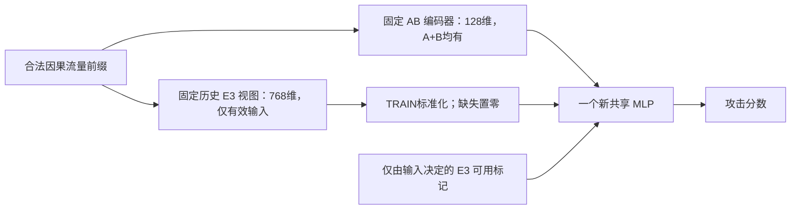

# 统一系统下一能力基线：直接使用旧 E3 表示，保留全流量表示

2026-09-14。性质：设计与静态审查。真实 P/T/E 均未启动。
配方：`unified_dual_view_capability_recipe_v1_20260914.json`；证据及身份：同前缀 `evidence` JSON。
用户本轮“可以，动手”“继续吧”承接底座兼容性与训练方案设计，不是新真实执行授权。

## 1. 选定的方案与它要回答的问题

选择已有 netFound E3 作为补充预训练表示，保留现有 AB 编码器作为所有合法 A+B 输入的共同内容路径，
训练一个新的共享检测头。先做一次普通监督能力基线，不继续让小 GRU 模仿旧 P2 的输出或中间特征。
主问题是：**在同一批合法训练支持上，直接加入已有 E3 表示，能否提高扩展攻击能力，同时保住已覆盖正常流量低误报？**
困难未见正常 OOD 的代价仍完整衡量，不能因目标澄清就把旧失败改称成功。

这是“两种表示、一个共享检测头”，不是一个已支持任意协议的预训练编码器。
AB 分支仍是固定的 131→64→GRU128；E3 分支提供 768 维表示，只在旧输入语义有效时存在。
不支持 E3 的 B 输入仍有完整 AB128 内容与真实标签训练，不再走旧 P2 的缺失即报警路径。
但 B 没有因此获得新的预训练表示，不能提前宣称其攻击泛化已改善。

与 H_AB 的实质差别是增加了原先 GRU/head 没有直接得到的表示内容，包括旧头字段、早期 burst 历史与预训练参数产生的表示。
新 MLP/冻结编码器/拼接本身不是论文创新。这个基线先判断已有知识能否被新系统实际使用，不能替代后续机制贡献与独立评估。
历史 CKDC 关闭的是 P2/M7 决策抑制与无覆盖正常证书，没有训练过本次 AB128+E3768 的共享特征头。

## 2. 为什么不直接宣称“扩展 E3 即可吃所有流量”

固定官方 tokenizer 定义 TCP=6、UDP=17、ICMP=1 的无 payload 布局；本项目实际 session/adapter 只接收 TCP/UDP。
`netFoundEmbeddings.py` 的协议表只有 18 行，GRE47、ICMPv658、非 IP 等没有已合格的对应原生语义。
已有协议槽位与字段布局，不等于本项目 ICMP 方向、会话、单位及前缀实现已合格；不能伪装协议号。

还发现项目 adapter 与固定官方预处理源码有实际差异：官方 Tokenize.py 先将 ns IAT 转成 μs，
tokenizer 再乘 1e-3；项目直接将 ns 交给 tokenizer，最终数值单位相差 1000 倍（含整数舍入，并非每行恰好成比例）。
同方向 burst 间隔基准和初始 ACK 参照更新方式也有差异。源码差异不能证明本地 checkpoint 的全部预训练语料
恰好经过所读版本，更不能据此宣布旧结果无效或当前失败已找到唯一原因。

**首试明确保留历史 E3 缓存的实际语义，不修单位、不扩 ICMP、不换会话边界、不重做旧实验。**
包括旧 adapter 对 IPv6 字段的映射；这里称“历史 E3 有效视图”，不称“完全官方等价原生输入”。
E3 是旧双向五元组会话截至每个目标的因果前缀，最早 12 bursts×6 packets，固定 masked-mean pooling；
AB 是 F0 已冻结的短因果 context。不同历史窗口属于此次 E3 视图的整体增量，不能归因成纯预训练权重效应。
E3 内部双向注意力不能整条未来会话编码后切片；只接受有历史前缀身份证明的已存目标表示。

采用本地 E3 的依据是已有实测攻击优势、完整权重身份与现成缓存，而不是模型新旧排名。
本轮核对了 netFound v5 原始公开正文、固定源代码及本地历史经验；没有穷尽全网模型，也没有下载新权重或数据。
当前没有证据表明换另一个模型就能自然覆盖非 IP、解决来源偏移并降低 OOD 误报，因此不同时展开模型搜索。

## 3. 合法训练支持与不可混淆的目标

| 角色 | 攻击 | 正常 | 总量 | E3 有效/缺失 |
|---|---:|---:|---:|---:|
| TRAIN | 3428 | 11645 | 15073 | 9402 / 5671 |
| CHECK | 825 | 2368 | 3193 | 2127 / 1066 |
| expanded | 244050 | 18000 | 262050 | 197268 / 64782 |

TRAIN A=3357攻击+6045正常，B=71攻击+5600正常。CHECK B 攻击为 0，不能声称 B 攻击泛化已验证。
旧教师选择器只取 9379 个“教师正确”的 A TRAIN，本次严禁复用这个条件：23 个旧教师判错的正常目标同样必须有 E3 内容。
可用标记 m=1-old_missing，只由固定输入语义与因果缺失状态决定，不能读取 label、old_hard、旧分数或评估角色来决定 m。

| 正常来源族 | TRAIN | CHECK |
|---|---:|---:|
| building-monitor | 2678 | 526 |
| combined-cycle | 2909 | 691 |
| combined-cycle-tls | 1123 | 286 |
| domotic-monitor | 1566 | 234 |
| ToN normal | 3369 | 631 |

CHECK 是同来源/文件的不同依赖组件，并非跨新设备测试；ID151 已包含在 TLS 的 286 及正常 2368 中。
四个 expanded 正常池（hydraulic、street camera、predictive maintenance、stream consumer）在本 TRAIN 中均为 0。
它们在旧 P2 fit 中同样没有训练目标；旧 `ood_val` 是 building-monitor，不能误认成 hydraulic。
旧 18398 fit 减去 132 个跨分区排除与 3193 CHECK，正好是当前 15073 TRAIN，没有失踪的一批合法训练数据。
攻击训练中 93.41% 来自 ToN 两族，22 source_groups/24 members 均单标签，来源捷径风险仍存在。

不把 CHECK、expanded 或封闭 select/viewed/FINAL 加回训练；也不把 18000 未见正常查询改为入网参考。
本轮不需要等待新设备数据才能检验基础能力；之后的入网机制需要另行合格的正常参考与同设备攻击查询。

## 4. 一次匹配对照，固定学习规则

只训练两臂，各一次：

- U0：`[z_AB128, zero768, m]`，零内容对照。
- U1：`[z_AB128, z_E3768_if_available_else_zero, m]`，真实内容候选。

两臂共用相同 TRAIN UID 顺序、m、标准化、897→128 ReLU→Dropout(0.10)→1 结构、初始参数、随机顺序和优化规则。
每头 115073 参数；AB 编码器 82944 参数固定，旧 AB head 丢弃，旧 P2 head/logits/normalizer 均不进入训练。
AB 表示提取必须使用 eval()、no_grad/inference_mode，全部编码参数 requires_grad=False；
P/E 提取前后核对固定 tensor 身份，不产生编码器梯度或优化器状态，只取目标时刻 GRU hidden。
T 入口/出口只验证 P 封存的编码器身份 receipt 与表示数组 hash，不为核验额外加载 AB。
两臂参数槽位数相同，但 U0 零输入列无数据梯度，不能声称有效模型容量完全相同。无需另加随机 E3 第三臂。

标准化：AB 使用全部 15073 TRAIN；E3 使用全部 9402 有效 TRAIN。按 UID 排序，以 float64 计算逐维均值及
总体标准差 ddof=0，零标准差设为 1，无 clipping。变换后转 float32；E3 缺失在标准化后置零，m 保持 0/1。
CHECK/expanded 不参与统计。旧 P2 normalizer 曾接触当前 CHECK，禁止复用；外部预训练语料只有“无已知重叠”，没有完整排重证明。

监督采用有历史依据的旧 P2 普通训练规则：类别均衡逐目标 BCE，权重 N/(2N_y)，
各 minibatch 按实际行数取 mean，包括最后不足 256 行的一批；不做 owner/context/family 均衡或 KD/guard。
AdamW lr=0.001、weight_decay=0.0001、betas=(0.9,0.999)、eps=1e-8；clip global grad L2=1；其余具体 flags 见 JSON。
seed2705；CPU float32，4 intra-op/1 inter-op，deterministic；每臂重新设种子并使用独立 seed2705 Generator 的 randperm。
UID 初始排序固定；50 epochs、batch256，每臂 2950 更新/753650 标签呈现，两臂共 5900 更新。
仅最后第 50 轮模型，不选最佳轮，不用 CHECK 早停/选阈值，不增加臂或调参。

这套训练规则与现 AB/H_AB 不同，差异是公开的；新增内容的因果比较是 U1-U0，旧模型是历史能力参考。
所有可训练模块只接收真实标签；AB 编码器的历史训练暴露两臂相同。旧 P2 fit/select 接触史单独披露。

## 5. 复用缓存与执行顺序

元数据与已封存清单证明，现有 E3 fit/select 缓存覆盖 25467×768，report 缓存覆盖 262050×768。
首试设计为 **零新原始包解码、零 E3 模型加载/forward、零下载/HPC**，仅提取授权 UID 的历史表示。
当前没有打开这两个缓存的数值内容；真实执行前必须按新配方核验身份、schema、行映射、缺失位和角色隔离。
旧 expanded 授权排除了 E3 数值缓存，本轮设计不会追认这项访问；未来 E 授权须明确包含该缓存的这 262050 行。

P：只准备 TRAIN 的 AB128 与合法 9402 行 E3 内容，封存 UID、输入身份、mask、标准化和表示矩阵；不训练。
同一压缩 npz 含禁用 select 行时，可按字节流经过压缩容器，但仅将获准 representation 行转为数值，
禁止 `np.load(...)[representation]` 全量解码后筛选。其余行不物化为 tensor/array，也不用于统计。
TRAIN/CHECK 组件应同时包含旧 E3 会话与新 F0 context 的依赖隔离；不匹配即停止，不能减少分母掩盖问题。
这项依赖分组已有封存：6000 条旧 session/新 context 及 B 桥接边，跨角色 0；本次复用 membership/components/edges，
核验身份及当前 UID，不重做全池普查。`transfer_prepare_v1.select_rows` 可作为选择性行读取参考，
不复用该模块的 contributions/教师筛选；`transfer_io_v2` 只有进度日志功能。

T：两个新 head 顺序各训一次，复用 P 的固定表示，冻结主干不再每轮 forward；结束核验并封存。
E：T 两臂完整封存后，才准备 CHECK 与 expanded 的 AB128，并取得各角色获准 E3 行，两个终点一起评估。
TRAIN 末态检查复用 P 表示；每臂总评分目标 280316=15073+3193+262050，无额外 ID forward。
AB 编码表示在两臂间复用，同一因果 context 内按目标位置取 GRU 状态；不同角色不共享有未来内容的缓存。
这是新表示缓存准备，不是历史实验重跑。若已有缓存身份/前缀/权限不合格，停止并说明，不自动重解流量或启动 E3。

本地单 controller 管理 P→T→E，阶段核验通过后自动衔接；持久 progress.jsonl/status.html 报阶段、完成量、耗时、失败原因与最终 seal。
无 LLM 定时轮询。真实执行需一次明确覆盖具体 P→T→E 与 E3 缓存行的授权，正常转换不反复问。
实现及生成验收应覆盖两个训练臂和失败控制流程；不能用真实数据做 smoke/resource trial。
本版固定资源上限：P 1800s、T 1800s、E 3600s、单进程树总 RSS 8 GiB、新产物总量 4 GiB；单本地 worker。
这些是保守终止预算，不是完成时间实测或资源试验；超限/异常停止，零自动重试。

## 6. 结果怎么判断，如何避免再次“局部满分”

主能力表同时呈现 TRAIN、CHECK、expanded 总攻击/future/16族/A-B，以及所有正常池和 ID。
已知 CHECK 基线已经 823/825 攻击、0/2368 正常误报，因此 CHECK 只是保持条件，不能将再次通过解释为突破。
固定点一律新头 logit>=0。旧 P2 237631/244050 攻击、127027/131391 future 保持为历史参考；
旧 P2 B 缺失即全报警，需同时列共同 A 内容有效子集与每族，不能靠 B 全报警达到“继承”。
future-query 不等于完全未见攻击族；同一开发池反复暴露，所有收益仍是开发证据。

U1-U0 是内容增量对照；U1-AB 是有效起点比较，C0_AB/H_AB/旧 P2 仅用已有分数，不重跑。
保留原六指标的精确 joint/TRADEOFF 规则：攻击召回、future、族 macro、池均 FPR、最差池 FPR、TPR@1% pooled OOD FPR。
同时必须列 0.1% 点、每族每池、正负翻转及尾部组成；不能只引用对自己有利的平均值。
1%/0.1% 仍使用同 18000 未见正常 OOD 分母，至多 180/18 FP，按完整相同分数组处理 ties；不是部署阈值，也不反哺训练。
旧 P2 若只有硬判定，不伪造其 ROC；ID151 不支持 0.1% 总体误报保证。

额外单列目标澄清后的事实：expanded 攻击是否改善、CHECK 正常是否仍零误报、旧攻击参考是否达到。
若攻击改善但未见正常尾部恶化，准确称为“攻击增益伴随未见正常风险/TRADEOFF”，不是联合成功或可以上线。
不事后发明允许损失百分比；微小单 seed 差异不证明稳健提升，不能用 CHECK 遮住 expanded 的族/池崩塌。

停止与后续：

- 若 U1 相对 U0 没有有效能力增量，或只有训练/CHECK 满分：结束这个双视图头配方，不调头、权重、轮数继续找赢点。
- 若 U1 相对 U0 与 AB 同时满足原六项联合改善，且 CHECK 保持、0.1% 与族/池细项未掩盖回退：仅作为进一步独立能力验证的开发候选。
- 若有攻击增益但 OOD 代价：保留能力增量证据并解释具体损失，仍无自动部署/入网晋级。下一设计必须针对真实训练覆盖缺口或可覆盖 B 的有效表示，不进行相邻头微调。
- 新设备正常参考的资格审查不需要假装未见 OOD 已解决；入网机制本身另有正常适应与同设备攻击保持要求，当前 NOT_EVALUATED。

以上新目标分层不更改 H_AB 的 TRADEOFF、历史 strict FAIL、joint NOT_REACHED。

## 7. 证据、审查与交付边界

主要本地来源：20260914 目标记录；20260913 H_AB 结果与研究决策；固定 paired plan/membership；
`issue27ckda_d0_resource_pilot_v1.py`、`issue27ckda_d1_e3_embed_v1.py`、`issue27ckda_d1_e3_embed_local_twopass_v1.py`、
`issue27ckda_d1_representation_probe_v1.py`；官方 Tokenize.py/tokenizer/embeddings；旧缓存 SHA256SUMS。
独立审查纠正了教师正确性 mask 泄漏、ICMP 未合格、CHECK 天花板、容量归因、CKDC 失败范围与缓存访问边界。
详细路径、hash、训练族计数与公开文献副本身份见 evidence JSON；静态机械审查见 review 文件。
公开原始研究：[netFound v5](https://arxiv.org/html/2310.17025v5)，主要阅读协议语义、预训练/固定表示、来源捷径及限制。
其新版本不是本地旧 checkpoint 的语义等价证明，分类成绩不能外推本项目低误报性能。

solved: 一个有新增知识来源的具体基线、合法输入语义、匹配训练和结果解释已选定；并非核心能力已解决。
changed_mainline: yes（从新学生模仿旧头，转为直接补充已有预训练表示的统一系统基线）。
active_blocker: 新表示增量尚无实测；角色隔离缓存装配与新共享头执行器尚未实现/验收。
frozen: 本设计/配方科学选择；全部历史协议、结果、旧源码与无关修改保持。
superseded: 上一目标记录中“下一底座尚未选择”的状态；不把本设计解释为全协议 E3 已实现。
next_action: 实现这两臂及生成验收、状态页；通过后一次明确真实 P→T→E 授权自动完成，异常停止零重试。
