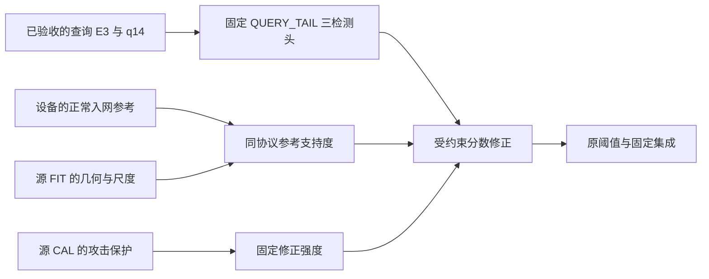

# 修复头接入受约束入网模块：新缓存谱系

2026-10-22。用户要求先评价完整方案，暂缓 DeepSeek 方案讨论和现代替换头。用户已启动代金券服务器并授权继续。

**最新 v3 已全部完成，结果 0.849 GiB 已本地备份并通过 SHA 校验。四策略的两池、三 seed 与集成共 32 个配对输出均零新增漏检；但四策略均未达到加权 FPR≤1% 门槛。B 的 B2 完整方案加权 FPR 从头单独 23.65666% 降至 16.59348%，A 的 B2 从 6.15818% 降至 6.14371%。详见 [完整结果与各策略对照](analysis/RESULT_REVIEW.md)、[备份回执](RESULT_BACKUP_VERIFIED_v3.json)。页面已显示完成，终态备份监听已退出；自动停机未启用，仍需用户手动节省停机。下方均为启动与修复历史，不代表仍在运行。**

v3 复用 v2 已完成的全部正常解码及六组参考特征，只接续评价。观察期端点与固定早期查询的 UID 重叠冲突，按原协议“早期查询保留、严格基础头回退”修复；97项测试通过，源角色/旧库互斥和全部时间因果检查保持。详见 [v3修复记录](fix_v3/README.md)。最终结果在 `pullback_v3/` 和 `final_state_v3/`。

**历史 v2：v1 因 TShark 的 root 身份提示触发严格 stderr 检查而停止，已修复 raw 子进程身份并以 v2 独立运行。93 项测试、两池真实解码输出逐字节对照通过，数据上传已完成。当时进度页跟踪 v2。详见 [修复记录](fix_v2/README.md)。v2结果备份为 `pullback_v2/`，旧监听为 `track_onboarding_v2.py`。**

当前：92 项目标环境测试 PASS；源 CAL、CIC_DEV、UNSW_DEV 三个池，QUERY_TAIL 三 seed 与固定集成的分数、判定逐位复现通过，同缓存 RECENT 对照也已核对。617,908 条源 FIT 推理与 104 条源参考已装载验证。小样/测试不等于入网效果结果。

正式服务 `paper04-onboarding-20261022-v1` 已提交且 active，当前为 WAIT_RAW_UPLOAD。两份正常捕获共 4,308,928,187 字节正在上传。服务器一次性等待完整文件并验 SHA，再自动运行；不会重做百万查询的 P/E3。上传完成前需要本机联网，进入计算后不依赖本机。

## 固定模型与比较

比较两个开发池中的 `OLD_BANK/B0/B1/B2`。B0 为首小时固定哈希抽样，B1 为同小时分层抽样，B2 为两小时；严格使用封存协议的设备、协议配额、独立组件与时间约束。无合格参考、参考不足及参考窗口前查询按原头回退，保留全部评价分母。源侧选定参数后才计算目标支持度，不以 A/B 标签或效果选参数。

输出包含头单独与整套系统的误报、召回、FP/FN、逐设备/协议及参考资格覆盖；零新增漏检是系统验收门槛，不是预先保证。三设备回归及独立确认尚未补齐，代码禁止将本次两池开发结果冒充全部验收 PASS。不会自动选最优 seed、阈值、参考策略或现代模型。

## 工程与证据

- 科学源：`../onboarding_configured_v1r1_20261017/bundle` 原样复制为 `package/frozen_onboarding`；原包未修改。协议 SHA `2fae0e1c…aaa4b5`。
- 新接入层 `src/new_onboarding_adapter.py` 明确绑定本次重建缓存和 12 头结果，历史父缓存逐位等价仍为 `PARENT_PARITY_UNAVAILABLE`。不伪造 Job177891 完成标记，不复用历史头分数。
- 路径适配：原头包裁剪掉原始解码文件；新入口在导入前明确选择入网封存包中的同字节 legacy 声明加载器，保持其相对依赖完整。未修改算法或路径常量。
- `validation/status.json`、`tests.json`、`tests.log`、`replay_proof.json` 保存真实目标验证；后者三个池均 `BITWISE_IDENTICAL`。正式服务再验证一次当前输入后进入参考准备。
- `package_receipt.json` 记录发布 tar、代码清单、配置与原科学包摘要；正式运行配置为 `package/config.json`。
- 系统约束：CPU 配额 8 核、MemoryMax 16 GiB、禁止 swap；数值线程 4；应用 RSS 14 GiB、工作目录 8 GiB、最少空闲 16 GiB。阶段串行、独立子进程；参数更新 0、自动重试 0。22 小时计算保护上限和 3 小时上传等待上限不是预计用时。
- 原始 PCAP 不在输出包中；编码器只复用已有冻结权重，导出保留其摘要与环境证据，避免重复下载权重及查询缓存。

## 运行、进度与备份

进度页面：[http://127.0.0.1:18764/](http://127.0.0.1:18764/)。新增“完整方案·修复检测头＋新设备入网”卡片；普通程序每 60 秒同步，不需要 AI 轮询。

云端目录：

- 软件：`/srv/paper04/onboarding_new_lineage_20261022_v1`
- 一次性启动协调：`/srv/paper04/onboarding_launch_20261022_v1`
- 结果：`/srv/paper04/runs/onboarding_new_lineage_20261022_v1`
- 状态：`/srv/paper04/services/onboarding_new_lineage_20261022_v1`
- 导出：`/srv/paper04/exports/onboarding_new_lineage_20261022_v1`

`track_onboarding.py` 在终态后拉回分块结果并校验全部 SHA，同时保存最终服务回执；下载前检查本地剩余空间，失败时保留服务器结果。若电脑睡眠或断网，恢复后重新运行该监听即可继续备份，不能重新提交已有实验。正式结果保存 `pullback/`，最终状态 `final_state/`，完成凭据 `RESULT_BACKUP_VERIFIED.json`。

**本次仍为用户手动节省停机。没有安装或启用新的停机权限；任务完成不会自动停止服务器计费。** 学校超算未操作，带宽未更改。
